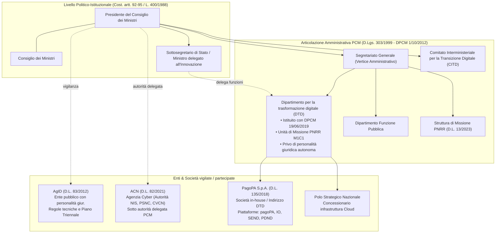
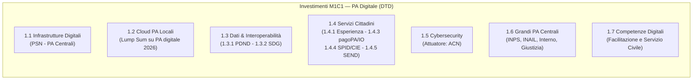
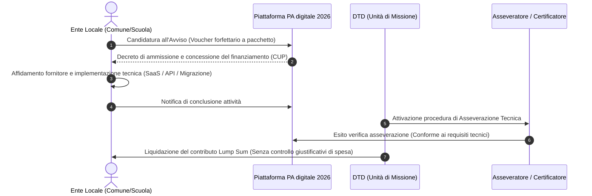

# Guida Completa Materie 8 e 9 — Concorso PCM DTD (Codice DTD1)
## Profilo: Specialista di settore scientifico tecnologico (80 unità)

---

## 🏛️ MATERIA 9: Ordinamento della Presidenza del Consiglio dei Ministri e Governance Digitale

Il candidato per il profilo tecnologico (DTD1) deve padroneggiare la catena istituzionale che va dal dettato costituzionale fino all'autonomia contabile, organizzativa e operativa del Dipartimento per la trasformazione digitale (DTD) e delle strutture collegate.

### 1. Quadro Architetturale della Governance

---

### 2. Le Fonti Primarie dell'Ordinamento PCM

| Fonte Normativa | Oggetto e Portata Applicativa |
| :--- | :--- |
| **Costituzione (artt. 92–96)** | Il PdC dirige la politica generale del Governo e ne è responsabile; mantiene l'unità di indirizzo politico e amministrativo coordinando l'attività dei Ministri. I Ministri sono responsabili collegialmente degli atti del CdM e individualmente dei propri dicasteri. |
| **Legge 23 agosto 1988, n. 400** | Disciplina dell'attività di Governo e ordinamento della PCM (art. 95 Cost.): • **Art. 2**: Competenze collegiali del CdM (DDL, decreti-legge, decreti legislativi, regolamenti). • **Art. 5**: Attribuzioni del PdC (direttive, coordinamento, sospensione atti ministeriali). • **Art. 9**: Ministri senza portafoglio (svolgono funzioni delegate dal PdC, si avvalgono di Dipartimenti della PCM). • **Art. 10**: Sottosegretari di Stato (il Sottosegretario alla PCM è Segretario del CdM). • **Art. 17**: Tipologie regolamentari (governativi con DPR e parere Consiglio di Stato, delegificazione c.2, ministeriali c.3). |
| **Decreto Legislativo 30 luglio 1999, n. 303** | Ordinamento della PCM (Riforma Bassanini): • Struttura di supporto per l'esercizio autonomo delle funzioni del PdC. • **Autonomia organizzativa (art. 7)**: il PdC individua con propri decreti le aree funzionali e i Dipartimenti. • **Autonomia contabile e di bilancio (art. 8)**: bilancio autonomo della PCM iscritto in apposito capitolo dello stato di previsione del MEF. • **Ruolo del personale e CCNL autonomo**: Comparto autonomo PCM (categoria A, posizione F1). • **Segretario Generale**: vertice amministrativo, responsabile delle risorse umane, finanziarie e strumentali. |
| **DPCM 1° ottobre 2012** (e s.m.i.) | Ordinamento delle strutture generali della PCM (Dipartimenti e Uffici di diretta collaborazione). |
| **DPCM 19 giugno 2019** | Istituzione del **Dipartimento per la trasformazione digitale (DTD)** all'interno della PCM (modifica del DPCM 1/10/2012). |

---

### 3. Il Dipartimento per la Trasformazione Digitale (DTD)

*   **Natura Giuridica**: Struttura dipartimentale interna alla PCM, **priva di personalità giuridica autonoma**. Opera alle dipendenze del Presidente o del Sottosegretario/Ministro con delega all'innovazione tecnologica e alla transizione digitale.
*   **Origine Storica**: Erede del *Team per la Trasformazione Digitale* (struttura commissariale straordinaria 2016–2019).
*   **Competenze Chiave**:
    1.  **Indirizzo Strategico**: Definizione della strategia *Italia Digitale 2026*, della *Strategia Cloud Italia* (redatta congiuntamente ad ACN) e della strategia per la banda ultralarga.
    2.  **Amministrazione Titolare PNRR**: Gestione diretta della Missione 1 Componente 1 (M1C1 - Digitalizzazione PA) e di misure di connettività in M1C2, mediante la propria **Unità di Missione PNRR**.
    3.  **Piattaforma PA digitale 2026**: Canale ufficiale per la pubblicazione degli avvisi, la candidatura degli enti territoriali, l'asseverazione tecnica e l'erogazione dei fondi lump sum.
    4.  **Governance delle Partecipate**: Esercizio dei poteri di indirizzo e coordinamento su **PagoPA S.p.A.** (società in-house pubblica istituita ex art. 8 D.L. 135/2018).
    5.  **Polo Strategico Nazionale (PSN)**: Gestione e vigilanza sulla convenzione/concessione pubblico-privata per l'infrastruttura cloud nazionale.
    6.  **Fondo per la Repubblica Digitale**: Sostegno ai progetti per le competenze digitali (art. 29 D.L. 152/2021).

---

### 4. Matrice dei Ruoli nella Governance del Digitale Pubblico

| Soggetto | Inquadramento Giuridico | Missione e Compiti Principali |
| :--- | :--- | :--- |
| **DTD** | Dipartimento interno PCM | Strategia nazionale, titolarità PNRR M1C1, gestione avvisi su *PA digitale 2026*, indirizzo PagoPA S.p.A. e PSN. |
| **AgID** | Agenzia di diritto pubblico (D.L. 83/2012), vigilata dal PdC | Regolamentazione tecnica vincolante (Linee Guida CAD ex art. 71), redazione Piano Triennale ICT, accreditamento fornitori fiduciari. |
| **ACN** | Agenzia pubblica di sicurezza nazionale (D.L. 82/2021) | Autorità Nazionale NIS (D.Lgs. 138/2024), gestione CSIRT Italia, Perimetro di Sicurezza Nazionale Cibernetica (PSNC), qualificazione servizi cloud PA, vigilanza AI Act con AgID. |
| **PagoPA S.p.A.** | Società interamente pubblica (in-house) | Sviluppo, gestione e diffusione di piattaforme abilitanti: nodo pagoPA, App IO, SEND (piattaforma notifiche), PDND (interoperabilità dati). |
| **Polo Strategico Nazionale (PSN)** | Società di scopo in concessione pubblico-privata | Erogazione di servizi cloud certificati ad alta affidabilità per PA centrali e strutture sanitarie locali. |
| **CITD** | Comitato interministeriale presso PCM (D.L. 22/2021) | Coordinamento strategico tra i ministeri per la transizione digitale. |

---

## 🚀 MATERIA 8: PNRR e le Misure sulla Digitalizzazione

Il Piano Nazionale di Ripresa e Resilienza è attuativo del **Next Generation EU** (Regolamento UE 2021/241 istitutivo del Dispositivo per la Ripresa e la Resilienza - RRF).

### 1. Principi e Regole di Funzionamento del PNRR

*   **Natura Performance-Based**:
    *   L'Unione Europea eroga le risorse a tranche semestrali solo a fronte del conseguimento certificato di specifici traguardi:
        *   **Milestone**: Traguardi qualitativi (approvazione di norme, operatività di piattaforme, stipula convenzioni).
        *   **Target**: Traguardi quantitativi (numero di enti migrati in cloud, volume di API pubblicate, percentuale di popolazione coperta).
    *   Non si applica il modello tradizionale del rimborso a piè di lista delle spese effettive sostenute.
*   **Principio DNSH (*Do No Significant Harm*)**:
    *   Ai sensi dell'art. 17 Reg. (UE) 2020/852 (Tassonomia verde), nessun intervento deve recare danno significativo all'ambiente.
    *   Per il digitale: requisiti stringenti di efficienza energetica nei data center (PUE monitorato), conformità standard RAEE e sostenibilità ciclo di vita hardware.
*   **Vincoli Trasversali**:
    *   Quota per la transizione digitale: **≥ 20%** delle risorse complessive del Piano (l'Italia supera il 25%).
    *   Quota per la transizione ecologica: **≥ 37%**.
    *   Quota di riserva territoriale: **≥ 40%** delle risorse territorializzabili destinato al Mezzogiorno.
    *   Parità generazionale e di genere; divieto di doppio finanziamento (*no double funding*).
*   **Strumenti di Monitoraggio e Controllo**:
    *   Piattaforma **ReGiS** (MEF - Ispettorato Generale PNRR): obbligatoria per il tracciamento procedurale, fisico e finanziario.
    *   Attribuzione obbligatoria del Codice Unico di Progetto (**CUP**).
    *   Governance nazionale: Cabina di Regia presso PCM (D.L. 77/2021) e Struttura di Missione PNRR presso PCM (D.L. 13/2023).

---

### 2. Le 7 Missioni del PNRR

| Missione | Ambito d'Intervento |
| :--- | :--- |
| **M1** | **Digitalizzazione, innovazione, competitività, cultura e turismo** |
| **M2** | Rivoluzione verde e transizione ecologica |
| **M3** | Infrastrutture per una mobilità sostenibile |
| **M4** | Istruzione e ricerca |
| **M5** | Inclusione e coesione |
| **M6** | Salute (M6C2: Fascicolo Sanitario Elettronico FSE 2.0 e telemedicina) |
| **M7** | REPowerEU (capitolo energetico aggiunto nel 2023) |

#### Articolazione della Missione 1 (M1)
*   **M1C1**: *Digitalizzazione, innovazione e sicurezza nella PA* (competenza primaria DTD, Funzione Pubblica, Giustizia).
*   **M1C2**: *Digitalizzazione, innovazione e competitività nel sistema produttivo* (Banda ultralarga, Italia 5G, Transizione 4.0).
*   **M1C3**: *Turismo e cultura 4.0*.

---

### 3. M1C1: Gli Investimenti di Digitalizzazione PA (Titolare: DTD)

| Sub-Investimento | Titolo e Dotazione | Contenuti Operativi e Architetturali |
| :--- | :--- | :--- |
| **1.1** | **Infrastrutture digitali (PSN)** | Migrazione dei sistemi IT delle **amministrazioni centrali** e delle strutture sanitarie verso il Polo Strategico Nazionale (PSN) o infrastrutture cloud ad alta affidabilità. Riduzione dell'impronta carbonica e consolidamento data center. |
| **1.2** | **Abilitazione e migrazione al cloud (PA locali)** | Piani di migrazione per Comuni, scuole, ASL. Erogazione tramite avvisi standard a **importo forfettario (lump sum)** sulla piattaforma *PA digitale 2026*. Modelli: *Lift & Shift* (Rehost) vs *Cloud Native* (Repurchase SaaS / Replatform). |
| **1.3.1** | **PDND (Piattaforma Digitale Nazionale Dati)** | Attuazione art. 50-ter CAD, gestita da PagoPA S.p.A. Catalogo API REST standard per l'interoperabilità tra banche dati della PA (*once-only principle*). Sicurezza basata su OAuth2/JWT e profili interoperabilità ModI AgID. |
| **1.3.2** | **Single Digital Gateway (SDG)** | Attuazione Regolamento (UE) 2018/1724 (*Your Europe*). Integrazione transfrontaliera delle procedure amministrative chiave per cittadini e imprese dell'UE. |
| **1.4.1** | **Esperienza del cittadino nei servizi pubblici** | Standardizzazione dell'interfaccia utente dei portali web e dei servizi dei Comuni e delle Scuole secondo i kit di sviluppo *Designers Italia*. Accessibilità (WCAG 2.1), usabilità e architettura informativa standard. |
| **1.4.3** | **Adozione piattaforme pagoPA e App IO** | Diffusione capillare dei pagamenti elettronici e accentramento delle comunicazioni e dei servizi digitali sull'applicazione mobile *IO*. |
| **1.4.4** | **Identità digitale e ANPR** | Sostegno all'adozione di SPID e Carta d'Identità Elettronica (CIE); integrazione delle anagrafi locali e dei servizi certificativi nell'Anagrafe Nazionale della Popolazione Residente (ANPR). |
| **1.4.5** | **Piattaforma Notifiche Digitali (SEND)** | Semplificazione della notifica a valore legale degli atti amministrativi verso cittadini e imprese (art. 26 D.L. 76/2020), con risparmio sui costi postali e tracciamento certo. |
| **1.5** | **Cybersecurity** (Soggetto attuatore: **ACN**) | Rafforzamento della postura cyber delle PA, implementazione della rete nazionale dei CSIRT/SOC territoriali, laboratori CVCN, potenziamento del Perimetro di Sicurezza Nazionale Cibernetica. |
| **1.6** | **Digitalizzazione Grandi PA Centrali** | Piani dedicati per grandi enti nazionali: INPS, INAIL, Ministero dell'Interno, Ministero della Giustizia, Guardia di Finanza. |
| **1.7** | **Competenze digitali di base** | Rete dei centri di facilitazione digitale sul territorio e Servizio Civile Digitale per elevare il livello di alfabetizzazione digitale dei cittadini. |

#### Le Riforme di Supporto a M1C1
*   **Riforma 1.1**: Semplificazione del processo di acquisto di soluzioni e servizi ICT (fast track per procurement tecnologico).
*   **Riforma 1.2**: Supporto operativo e territoriale alla trasformazione digitale delle PA locali (Transformation Office / PMO di supporto).
*   **Riforma 1.3**: Linee guida *Cloud First* e classificazione dei dati e dei servizi della PA in tre livelli: **Ordinari**, **Critici**, **Strategici** (in conformità ai criteri AgID/ACN).

---

### 4. Meccanismo Operativo di PA Digitale 2026: Voucher Lump Sum e Asseverazione

Nelle selezioni concorsuali è frequente la verifica del modello di gestione dei bandi PNRR adottato dal DTD per gli enti territoriali:

1.  **Voucher a pacchetto (Lump Sum)**: L'ente riceve un importo fisso predeterminato in base alla dimensione demografica e alla tipologia di servizio migrato/attivato.
2.  **Principio del Risultato**: Non si inviano fatture o giustificativi di costo; l'erogazione è subordinata unicamente alla verifica del raggiungimento dell'obiettivo.
3.  **Asseverazione Tecnica**: Procedura (automatizzata o manuale a campione) condotta dal DTD o da suoi delegati (es. PagoPA, AgID) per collaudare il corretto funzionamento del servizio in conformità alle Linee Guida.

---

### 5. Target Strategici di Riferimento

*   **Italia Digitale 2026 (Target Nazionali)**:
    1.  **70%** della popolazione con competenze digitali di base.
    2.  **75%** delle amministrazioni pubbliche che utilizzano servizi in cloud.
    3.  **80%** dei servizi pubblici essenziali erogati online.
    4.  **70%** dei cittadini provvisti di identità digitale (SPID o CIE).
    5.  **100%** delle famiglie e imprese coperte da reti ultraveloci (1 Gbps).
*   **Decennio Digitale Europeo 2030 (Decisione UE 2022/2481)**:
    *   Servizi pubblici digitali chiave: **100%** online per cittadini e imprese.
    *   Cartella clinica elettronica (EHR): **100%** dei cittadini con accesso digitale.
    *   Identità digitale europea (eID Wallet): **80%** di diffusione tra i cittadini.
    *   Infrastrutture gigabit per tutti e connettività 5G in tutte le aree popolate.

---

## 🎯 Punti di Attenzione e Trabocchetti Tipici nei Quiz Concorsuali

1.  **Natura del DTD**:
    *   *Trabocchetto*: "Il DTD è un'agenzia governativa con autonomia patrimoniale".
    *   *Risposta corretta*: Falso. Il DTD è un **ufficio generale della PCM**, non ha personalità giuridica né bilancio societario separato.
2.  **Differenza tra AgID e ACN**:
    *   *AgID*: Competente per il CAD, le Linee Guida tecniche, il Piano Triennale ICT e l'interoperabilità generale.
    *   *ACN*: Competente per la cybersicurezza nazionale, il CSIRT Italia, il perimetro di sicurezza cibernetica (PSNC), la direttiva NIS2 e la qualificazione cloud di sicurezza.
3.  **Ruolo di PagoPA S.p.A.**:
    *   È una società pubblica in-house controllata dallo Stato; il DTD ne esercita l'indirizzo e il coordinamento strategico. Gestisce piattaforme strategiche (pagoPA, IO, SEND, PDND), ma **non** emana linee guida regolamentari generali (compito riservato ad AgID).
4.  **Meccanismo di Erogazione PNRR M1C1**:
    *   *Trabocchetto*: "I Comuni inviano i mandati di pagamento e le fatture quietanzate su PA digitale 2026 per ottenere il rimborso dei costi vivi sostenuti".
    *   *Risposta corretta*: Falso. L'erogazione è a **somma forfettaria (lump sum)** a fronte dell'**asseverazione del raggiungimento del risultato**.
5.  **Atti del Governo (L. 400/1988)**:
    *   *Decreti Legislativi*: Emanati su delega del Parlamento ex art. 76 Cost.
    *   *Decreti-Legge*: Emanati in casi di straordinaria necessità e urgenza ex art. 77 Cost.; decadono se non convertiti entro **60 giorni**.
    *   *Regolamenti Governativi*: Emanati con D.P.R. previa deliberazione del CdM e sentito obbligatoriamente il parere del **Consiglio di Stato**.
