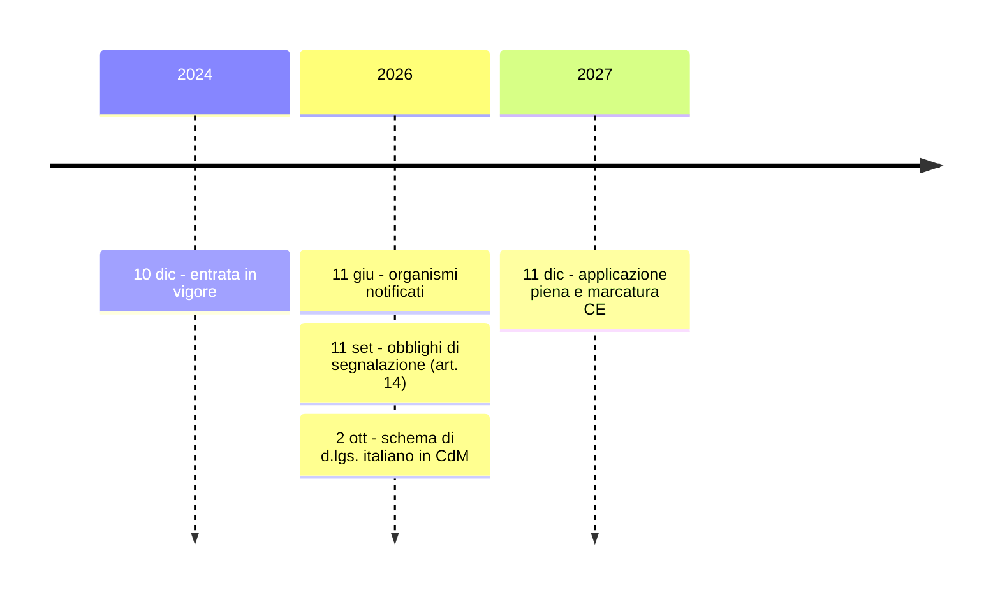

# Cyber Resilience Act (CRA) — Reg. (UE) 2024/2847

> **Perché è importante per l'orale DTD1**:
> - rientra nella materia 7 (privacy e sicurezza);
> - è collegato all'**SBOM**, che è uscito allo scritto (Q56);
> - riguarda gli acquisti ICT della PA;
> - è materia di attualità: gli **obblighi di segnalazione si applicano dall'11 settembre 2026** e lo **schema di decreto italiano** è del 2 ottobre 2026;
> - si aggancia direttamente alla tua esperienza al **COR**.
>
> **Fonti**: Reg. (UE) 2024/2847 (EUR-Lex); ENISA, pagina CRA e Single Reporting Platform; Commissione UE, pagina *CRA reporting*; per lo stato italiano, Cybersecurity360 e ICT Security Magazine del 7 e 13 ottobre 2026. Prima dell'orale **verifica su governo.it e Normattiva** se il decreto è stato approvato in via definitiva e pubblicato in Gazzetta Ufficiale.

## 1. Coordinate e calendario
| Data | Che cosa succede |
|---|---|
| **10/12/2024** | Entrata in vigore del regolamento (pubblicato nella GUUE del 20/11/2024) |
| **11/06/2026** | Si applicano le norme sulla **notifica degli organismi di valutazione della conformità** (capo IV) |
| **11/09/2026** | Si applicano gli **obblighi di segnalazione** (art. 14), anche per i prodotti già sul mercato. È attiva la **Single Reporting Platform** di ENISA |
| **11/12/2027** | **Applicazione piena**: requisiti essenziali, valutazione della conformità, **marcatura CE** |

## 2. Che cosa regola
- **Oggetto**: i **prodotti con elementi digitali**, cioè hardware e software, comprese le soluzioni di elaborazione remota dei dati, che si collegano direttamente o indirettamente a un dispositivo o a una rete. Il CRA è il primo regolamento UE che fissa **requisiti di cybersicurezza orizzontali sui prodotti**, lungo tutto il loro **ciclo di vita**.
- **Logica**: è una normativa sul **prodotto**, come la direttiva macchine, con marcatura **CE**. La NIS2 invece riguarda il **soggetto** e la sua organizzazione.
- **Esclusi**:
  - i settori che hanno già una disciplina propria (dispositivi medici, veicoli, aviazione, equipaggiamento marittimo);
  - i **SaaS puri**, che ricadono sotto la NIS2;
  - il **software open source sviluppato fuori da un'attività commerciale**;
  - i prodotti sviluppati o modificati **esclusivamente per la sicurezza nazionale o la difesa** e quelli progettati per trattare **informazioni classificate**. *Questo è un aggancio con il COR: dillo, ma non entrare nei dettagli.*
- **Open source**: chi sostiene stabilmente un progetto open source destinato ad attività commerciali è un **open-source software steward**. Ha un regime **alleggerito**: una politica di cybersicurezza, la collaborazione con le autorità e la segnalazione.

## 3. Le categorie di prodotti
| Categoria | Esempi | Valutazione della conformità |
|---|---|---|
| **Default** (circa il 90% dei prodotti) | app, giochi, software di consumo, molti dispositivi IoT | **Autovalutazione** del fabbricante (modulo A) |
| **Importanti – Classe I** (All. III) | gestione delle identità, **password manager**, browser, **VPN**, **SIEM**, router, sistemi operativi, smart home | Autovalutazione **solo se** si applicano norme armonizzate; altrimenti serve una terza parte |
| **Importanti – Classe II** (All. III) | **hypervisor** e container runtime, **firewall**, **IDS/IPS**, microprocessori *tamper-resistant* | **Valutazione di terza parte** (organismo notificato) |
| **Critici** (All. IV) | smart card, gateway degli smart meter, *hardware security box* | Possibile **certificazione europea** obbligatoria (schema **EUCC**, Cybersecurity Act) |

## 4. Obblighi del fabbricante
- **Requisiti essenziali** (All. I, parte I):
  - **secure by default**;
  - **nessuna vulnerabilità sfruttabile nota** al momento dell'immissione sul mercato;
  - protezione da accessi non autorizzati;
  - riservatezza, integrità e disponibilità;
  - **minimizzazione dei dati** e riduzione della **superficie d'attacco**;
  - **logging**;
  - **aggiornamenti di sicurezza**, automatici di default con possibilità di rinuncia.
- **Gestione delle vulnerabilità** (All. I, parte II):
  - **SBOM** in formato leggibile da una macchina, almeno per le dipendenze di primo livello. Non va pubblicata, ma esibita alle autorità;
  - politica di **coordinated vulnerability disclosure**;
  - **aggiornamenti di sicurezza gratuiti**, separati da quelli funzionali quando è possibile.
- **Periodo di supporto**: almeno **5 anni**, salvo che la vita attesa del prodotto sia più breve. Va **dichiarato** all'acquisto.
- **Documentazione**: documentazione tecnica, **dichiarazione UE di conformità**, marcatura **CE**, istruzioni d'uso per l'utente, che includono la data di fine del supporto.
- Ci sono obblighi a cascata anche per **importatori e distributori**.

## 5. Segnalazioni (art. 14) — in vigore dall'11/09/2026
Riguardano le **vulnerabilità attivamente sfruttate** e gli **incidenti gravi** che incidono sulla sicurezza del prodotto.

| Termine | Contenuto |
|---|---|
| **24 ore** | **Preallarme** (*early warning*) |
| **72 ore** | **Notifica** con le informazioni disponibili e le misure di mitigazione |
| **14 giorni** dalla disponibilità della correzione (per una vulnerabilità) / **1 mese** (per un incidente) | **Relazione finale** |

- La notifica si fa **una sola volta** sulla **Single Reporting Platform di ENISA**, che la indirizza al **CSIRT coordinatore** dello Stato membro (per l'Italia il **CSIRT Italia**, presso l'ACN) e all'ENISA.
- Il fabbricante deve anche **informare gli utenti** dell'incidente e delle misure da adottare.
- **Stessa scansione 24h / 72h della NIS2**: è un buon gancio mnemonico.

## 6. Sanzioni (art. 64)
| Violazione | Massimo |
|---|---|
| Requisiti essenziali e obblighi dei fabbricanti (artt. 13-14) | **15 mln €** o **2,5%** del fatturato mondiale |
| Altri obblighi | 10 mln € o 2% |
| Informazioni inesatte o fuorvianti alle autorità | 5 mln € o 1% |

Oltre alle sanzioni, le **autorità di vigilanza del mercato** possono imporre misure correttive, **ritiro** o **richiamo** del prodotto.

## 7. L'attuazione in Italia (stato al 13/10/2026 — **da verificare**)
- **Legge delega**: **L. 17 marzo 2026, n. 36** (legge di delegazione europea 2025), **art. 15**.
- **2 ottobre 2026**: il Consiglio dei ministri approva in **esame preliminare** lo schema di decreto legislativo. Seguono i pareri parlamentari e del Consiglio di Stato. Al 13 ottobre non risultava ancora la pubblicazione in Gazzetta Ufficiale.
- **ACN** è sia **autorità di notifica** sia **autorità di vigilanza del mercato** per i requisiti orizzontali di cybersicurezza, e può avvalersi della **Guardia di Finanza**. L'accreditamento degli organismi resta all'ente nazionale di accreditamento. Per gli apparati radio (Reg. delegato 2022/30) resta competente il **MIMIT**.
- **Altre autorità**:
  - **Banca d'Italia, Consob e IVASS** per i soggetti finanziari vigilati;
  - il **Garante privacy** per i profili di protezione dei dati;
  - le autorità della disciplina nazionale sull'IA per i prodotti che sono anche **sistemi di IA ad alto rischio**.
- **Misure di accompagnamento**: un canale di consulenza **ACN e MIMIT** per PMI e start-up, e una **sandbox CRA** sotto la supervisione dell'ACN.

## 8. Che cosa cambia per la PA (e per il DTD)
1. **La PA come acquirente** (il caso più frequente):
   - dall'11/12/2027 i prodotti con elementi digitali sul mercato UE dovranno avere la **marcatura CE ai sensi del CRA**;
   - nel capitolato conviene richiedere già oggi: **periodo di supporto** dichiarato, **SBOM** (anche solo su richiesta), politica di **vulnerability disclosure**, impegno agli **aggiornamenti di sicurezza**, **data di fine supporto** ed exit strategy;
   - per le categorie importanti o critiche, evidenza della **valutazione di terza parte** o della certificazione.
2. **Il collegamento con le norme nazionali sugli appalti ICT**:
   - **L. 90/2024, art. 14**: elementi essenziali di cybersicurezza nei contratti pubblici ICT, attuati con il **DPCM 30 aprile 2025**;
   - **NIS2 / d.lgs. 138/2024**: sicurezza della **catena di approvvigionamento**;
   - **PSNC** (D.L. 105/2019): verifiche **CVCN** per i beni ICT destinati a servizi essenziali.

   Il CRA **alza la base minima** del mercato, mentre queste norme aggiungono requisiti per gli usi più sensibili. L'art. 5 del CRA consente agli Stati requisiti **aggiuntivi** per specifici acquisti o usi, ad esempio per la sicurezza nazionale, se sono necessari e proporzionati.
3. **La PA come sviluppatrice**: il software sviluppato **per uso proprio** o rilasciato a riuso (art. 69 CAD, Developers Italia) **senza attività commerciale** in linea generale non è "messo a disposizione sul mercato". Va comunque valutato caso per caso. In ogni caso le **buone pratiche del CRA** (SBOM, gestione delle vulnerabilità, secure by default) coincidono con le **Linee guida AgID sullo sviluppo sicuro** e sulla **modellazione delle minacce** (`AGID/pdf/`).
4. **Vantaggio per i soggetti NIS2**: un fornitore conforme al CRA rende più semplice dimostrare la sicurezza della **supply chain**.

## 9. Il CRA e le altre norme
| Norma | Che cosa regola | Rapporto con il CRA |
|---|---|---|
| **NIS2** (Dir. 2022/2555; d.lgs. 138/2024) | **soggetti** essenziali e importanti | Complementare: il CRA rende sicuri i **prodotti** che i soggetti NIS2 acquistano; scadenze di notifica 24h/72h analoghe |
| **Cybersecurity Act** (Reg. 2019/881) | **certificazione volontaria** (EUCC) e mandato ENISA | La certificazione può diventare obbligatoria per i prodotti **critici** e vale come presunzione di conformità |
| **AI Act** (Reg. 2024/1689) | sistemi di IA | Per i sistemi di IA **ad alto rischio** che sono anche prodotti CRA, la conformità al CRA soddisfa i requisiti di cybersicurezza dell'art. 15 dell'AI Act |
| **RED** (Reg. delegato 2022/30) | sicurezza degli apparati radio | Il CRA la sostituirà per gli aspetti cyber |
| **GDPR** | dati personali | Il CRA attua la *security by design* sul prodotto, collegata alla *privacy by design* (art. 25) e alla sicurezza del trattamento (art. 32) |
| **DORA** (Reg. 2022/2554) | resilienza operativa del settore finanziario | Riguarda i soggetti finanziari; il CRA i prodotti dei loro fornitori |

## 🎙️ Copione (90")
> «Il **Cyber Resilience Act**, Reg. UE 2024/2847, è il primo regolamento europeo che fissa **requisiti di cybersicurezza obbligatori sui prodotti con elementi digitali**, hardware e software, per **tutto il loro ciclo di vita**. È una logica di prodotto, con **marcatura CE**, complementare alla **NIS2** che invece riguarda le organizzazioni.
> Il fabbricante deve progettare il prodotto **secure by default**, senza vulnerabilità sfruttabili note. Deve gestire le vulnerabilità con una **SBOM** e una politica di **disclosure coordinata**, e garantire **aggiornamenti di sicurezza gratuiti** per un periodo di supporto di norma di almeno **cinque anni**. Dall'**11 settembre 2026** deve segnalare le vulnerabilità attivamente sfruttate e gli incidenti gravi tramite la piattaforma unica dell'**ENISA**: preallarme in **24 ore**, notifica in **72**. L'applicazione piena arriva l'**11 dicembre 2027**. I prodotti più sensibili, come firewall o hypervisor, richiedono una valutazione di **terza parte**.
> In Italia lo schema di decreto legislativo, approvato in esame preliminare il 2 ottobre, designa l'**ACN** come autorità di vigilanza del mercato.
> Per la PA il CRA è soprattutto una **leva negli acquisti**: nei capitolati possiamo chiedere già oggi periodo di supporto, SBOM e gestione delle vulnerabilità. Il CRA si integra con gli elementi di cybersicurezza della **legge 90/2024** e con gli obblighi di supply chain della NIS2. Il compromesso: più costi di conformità per i fornitori, soprattutto le PMI, in cambio di meno rischio sistemico.»

## 🃏 Flashcard
| Domanda | Risposta |
|---|---|
| Numero del regolamento | **Reg. (UE) 2024/2847** |
| Che cosa regola, in una riga | Requisiti di cybersicurezza dei **prodotti con elementi digitali** lungo tutto il ciclo di vita |
| CRA vs NIS2 | Il CRA regola il **prodotto**, la NIS2 il **soggetto** |
| Da quando si applicano le segnalazioni? | **11 settembre 2026** (art. 14) |
| Applicazione piena | **11 dicembre 2027** |
| Termini delle segnalazioni | **24h** preallarme · **72h** notifica · relazione finale entro **14 giorni** dalla correzione (vulnerabilità) o **1 mese** (incidente) |
| A chi si segnala? | Alla **Single Reporting Platform ENISA** → CSIRT coordinatore (**CSIRT Italia**) + ENISA |
| Periodo minimo di supporto | **5 anni** (salvo una vita attesa più breve) |
| Che cosa deve contenere almeno la SBOM? | Le dipendenze di **primo livello**, in formato leggibile da una macchina |
| Firewall, IDS/IPS, hypervisor | **Classe II** → valutazione di **terza parte** |
| VPN, SIEM, password manager | **Classe I** → autovalutazione solo con norme armonizzate |
| Smart card, hardware security box | **Critici** (All. IV) → possibile certificazione **EUCC** |
| Prodotti per la difesa | **Esclusi** se sviluppati **esclusivamente** per sicurezza nazionale o difesa |
| Sanzione massima | **15 mln € o 2,5%** del fatturato mondiale |
| Autorità italiana di vigilanza | **ACN** (schema di d.lgs., CdM del 2/10/2026; delega L. 36/2026, art. 15) |
| Open-source steward | Regime **alleggerito** per chi sostiene stabilmente un progetto OSS usato commercialmente |

## 🧩 Mini-caso
*Il DTD deve acquistare una soluzione VPN e di gestione delle identità per i dipendenti, con un contratto di 4 anni che andrà oltre il dicembre 2027.*
→ **Prima analisi**: il valore supera la soglia di **140k** valida per la PCM, quindi verifico prima **Consip**. VPN e gestione delle identità sono **prodotti importanti di Classe I** del CRA.

**Nel capitolato** chiedo:
- conformità al CRA e **marcatura CE** entro l'11/12/2027, con dichiarazione UE di conformità;
- **periodo di supporto** che copra almeno la durata del contratto, più il tempo di migrazione;
- **SBOM** da fornire su richiesta e politica di **vulnerability disclosure**;
- impegno a notificare all'amministrazione le vulnerabilità sfruttate, in coerenza con l'art. 14;
- **aggiornamenti di sicurezza** con SLA;
- **exit strategy**.

**Raccordi**:
- elementi di cybersicurezza della **L. 90/2024** / DPCM 30/04/2025;
- requisiti di **supply chain NIS2**;
- criterio **OEPV** con premialità per certificazioni (ad esempio **EUCC**) e buone pratiche di sviluppo sicuro.

In esecuzione: il **DEC** verifica il rispetto degli impegni (art. 116).

## 🇬🇧 English corner
> *"The Cyber Resilience Act sets mandatory cybersecurity requirements for products with digital elements, such as software and connected devices. Manufacturers must ensure security by design, handle vulnerabilities, provide free security updates for the support period and, since September 2026, report actively exploited vulnerabilities within 24 hours. For public administrations, it is a powerful tool in procurement."*
