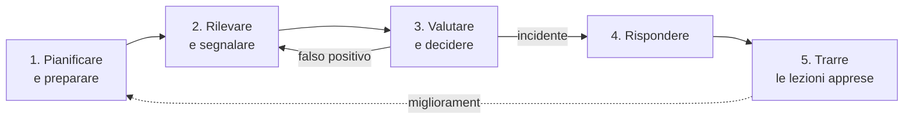

# ISO/IEC 27035 — Gestione degli incidenti di sicurezza delle informazioni

> **Perché è importante per l'orale DTD1**:
> - rientra nella materia 7 (privacy e sicurezza) e nelle domande di caso, per esempio «un dipendente segnala un ransomware» (`orale/02` §7.5);
> - è lo standard che dà il **metodo**, mentre NIS2, L. 90/2024, GDPR e CRA danno le **scadenze di notifica**;
> - è un terreno naturale per un **episodio STAR** dalla tua esperienza al COR (`orale/01` §4, riga 4), da raccontare senza dettagli classificati.
>
> **Fonti**: schede di catalogo ISO/IEC e IEC Webstore; ANSI blog su 27035-1:2023; iso27001security.com. I testi sono a pagamento: qui ci sono struttura e concetti, non citazioni testuali. Riferimenti collegati: ISO/IEC 27001:2022 Annex A; NIST SP 800-61 Rev. 3 (aprile 2025); D.Lgs. 138/2024; L. 90/2024; Reg. UE 2024/2847 (`orale/06`).

## 1. La famiglia 27035 (edizioni vigenti)
| Parte | Titolo (sintesi) | Edizione |
|---|---|---|
| **27035-1** | **Principi e processo** di gestione degli incidenti: il **modello a 5 fasi** | **2023** (sostituisce la 2016) |
| **27035-2** | Linee guida per **pianificare e preparare** la risposta e **trarre le lezioni apprese** | **2023** |
| **27035-3** | Linee guida per le **operazioni di risposta agli incidenti ICT** | 2020 |
| **27035-4** | **Coordinamento** tra più organizzazioni | 2024 (prima edizione) |

**Standard collegati**:
- **ISO/IEC 27001:2022**, che fissa i requisiti dell'ISMS. Nell'Annex A i controlli **5.24-5.28** e **6.8** rinviano di fatto alla 27035.
- **ISO/IEC 27002:2022**, che dà le linee guida su quei controlli.
- **ISO/IEC 27037**, per identificare, raccogliere e conservare le **evidenze digitali**.
- **ISO/IEC 27043**, per i principi delle indagini sugli incidenti.

## 2. Concetti chiave
- **Evento** di sicurezza: un fatto che *potrebbe* indicare una violazione o un guasto dei controlli, per esempio un alert del SIEM.
- **Incidente** di sicurezza: uno o più eventi che **compromettono o possono compromettere** le operazioni o le informazioni. Non ogni evento è un incidente: la fase *valuta e decidi* serve proprio a separarli ed evita il sovraccarico di falsi positivi.
- **Vulnerabilità**: una debolezza che può essere sfruttata. Va **segnalata e gestita** anche se non c'è ancora un incidente.
- **Ruoli**:
  - **PoC** (punto di contatto), che riceve le segnalazioni;
  - **IMT** (*Incident Management Team*), che governa il processo;
  - **IRT** (*Incident Response Team*), che opera sul campo, interno o esterno (per esempio un fornitore o un SOC).
- La 27035 è **compatibile con i CSIRT e i CERT** e chiede di definire un **sistema di classificazione** della gravità, una **policy** e un **piano**.

## 3. Il processo in 5 fasi (27035-1:2023)

| Fase | Che cosa si fa | Esempio in una PA |
|---|---|---|
| **1. Pianificare e preparare** | Policy, piano di risposta, ruoli (IMT/IRT/PoC), classificazione della gravità, strumenti (SIEM, EDR, log), contratti con i fornitori, **formazione ed esercitazioni** | Piano approvato dai vertici; contatti con il CSIRT Italia, il DPO e il fornitore; **referente per la cybersicurezza** (L. 90/2024) |
| **2. Rilevare e segnalare** | Monitoraggio, raccolta degli eventi, canali di segnalazione per utenti e terzi | Alert dell'EDR, un dipendente che segnala un'e-mail sospetta |
| **3. Valutare e decidere** | **Triage**: è un incidente? Quanto è grave? Si attiva l'IRT e si valutano gli **obblighi di notifica** | Classificazione «significativo» ai sensi della NIS2 → parte il conto delle 24 ore |
| **4. Rispondere** | **Contenimento → eradicazione → ripristino**; **raccolta delle evidenze** (ISO/IEC 27037, catena di custodia); comunicazioni; **escalation** a crisi se serve | Isolamento delle macchine, ripristino da **backup immutabili**, notifiche al CSIRT Italia e al Garante |
| **5. Trarre le lezioni apprese** | Analisi post-incidente, causa radice, aggiornamento di controlli, piano e analisi dei rischi, condivisione delle informazioni | Relazione finale (NIS2: entro 1 mese); azioni correttive nel **piano di trattamento del rischio** |

> **Gancio mnemonico: «P-R-V-R-L»** = **P**repara · **R**ileva · **V**aluta · **R**isponde · **L**ezioni. È il ciclo **PDCA** applicato agli incidenti: la fase 5 riparte dalla fase 1.

## 4. Raccordo con altri modelli (utile se la commissione cita un framework diverso)
| ISO/IEC 27035-1 | **NIST SP 800-61 Rev. 3** (2025, allineata al **CSF 2.0**) | Modello ACN a 5 fasi (guida per le PMI) | ISO/IEC 27001:2022, Annex A |
|---|---|---|---|
| 1. Pianificare e preparare | *Govern / Identify / Protect* (la preparazione diventa parte della gestione del rischio complessiva) | (1) Pianificazione | **5.24** pianificazione e preparazione |
| 2. Rilevare e segnalare | *Detect* | (2) Identificazione dell'evento | **6.8** segnalazione degli eventi |
| 3. Valutare e decidere | *Detect* (analisi) | (3) Gestione — rilevamento | **5.25** valutazione e decisione |
| 4. Rispondere | *Respond* + *Recover* | (3) Gestione — contenimento, eliminazione, ripristino + (4) Notifica | **5.26** risposta; **5.28** raccolta delle evidenze |
| 5. Lezioni apprese | *Identify — Improvement* | (5) Miglioramento continuo | **5.27** apprendimento dagli incidenti |

- La **Rev. 2 del NIST 800-61** (2012) usava 4 fasi: preparazione → rilevamento e analisi → contenimento, eradicazione e ripristino → attività post-incidente. Molti testi la citano ancora. La **Rev. 3** inserisce la risposta agli incidenti nelle **6 funzioni del CSF 2.0**.
- **ITIL 4**: l'*incident management* mira a **ripristinare il servizio**, mentre la 27035 mira alla **sicurezza** (evidenze, notifiche, causa radice). Nella pratica i due processi si **integrano**: l'incidente di sicurezza attiva anche il *problem management* e il *change management*.
- **Continuità operativa**: quando l'incidente diventa crisi entrano in gioco la **ISO 22301** (BCMS) e i piani di **disaster recovery** (RTO/RPO).

## 5. Le notifiche: lo standard dà il metodo, la norma dà i tempi
| Norma | Chi | A chi | Tempi |
|---|---|---|---|
| **NIS2** — D.Lgs. 138/2024 (art. 25) | soggetti essenziali e importanti | **CSIRT Italia** (ACN) | **24h** preallarme · **72h** notifica · **1 mese** relazione finale |
| **L. 90/2024** (art. 1) | PA centrali, Regioni, Comuni sopra i 100.000 abitanti e capoluoghi di regione, ASL e altri | ACN / CSIRT Italia | segnalazione **entro 24h**, notifica completa **entro 72h** |
| **PSNC** — D.L. 105/2019, DPCM 81/2021 | soggetti del Perimetro | CSIRT Italia | **1h** o **6h** secondo la categoria dell'incidente |
| **GDPR** (artt. 33-34) | titolare del trattamento | **Garante** (e interessati se il rischio è elevato) | **72h** dalla conoscenza della violazione dei dati personali |
| **CRA** (art. 14), dall'11/09/2026 | **fabbricanti** di prodotti | Piattaforma ENISA → CSIRT Italia | **24h / 72h / 14 giorni** (vulnerabilità) o 1 mese (incidente) |
| **DORA** (Reg. 2022/2554) | entità finanziarie | autorità di vigilanza (es. Banca d'Italia) | iniziale entro **4h** dalla classificazione come grave (e **24h** dalla conoscenza) · intermedia **72h** · finale **1 mese** |

> **Doppio binario**: un ransomware con esfiltrazione di dati personali richiede la notifica **sia** al CSIRT Italia (NIS2 o L. 90/2024) **sia** al Garante (GDPR). Sono obblighi **paralleli**, non alternativi. La fase 3 della 27035 è il punto in cui si fa questa valutazione.

## 🎙️ Copione (90")
> «La **ISO/IEC 27035** è la famiglia di standard sulla gestione degli incidenti di sicurezza delle informazioni. La **parte 1, del 2023**, definisce il processo in **cinque fasi**. La prima è **pianificare e preparare**: policy, piano di risposta, ruoli, classificazione della gravità ed esercitazioni. La seconda è **rilevare e segnalare** gli eventi. La terza è **valutare e decidere**, cioè capire se un evento è davvero un incidente e quanto è grave. La quarta è **rispondere**, con contenimento, eradicazione e ripristino, preservando le **evidenze**. La quinta è **trarre le lezioni apprese**, che riporta alla prima fase in una logica di miglioramento continuo. È il riferimento operativo dei controlli **5.24-5.28 della ISO 27001:2022** ed è coerente con il **NIST 800-61**.
> Lo standard dà il **metodo**, le norme danno i **tempi**. Per una PA, la **legge 90/2024** e la **NIS2** impongono la segnalazione al **CSIRT Italia** entro **24 ore** e la notifica entro **72**. Se sono coinvolti dati personali, c'è anche la notifica al **Garante** entro 72 ore. Dal settembre 2026 anche i **fabbricanti** devono segnalare, in base al **Cyber Resilience Act**.
> Il compromesso è tra **velocità e accuratezza**: notificare presto con informazioni incomplete, poi aggiornare. E tra **ripristino rapido** e **conservazione delle evidenze**: se ripristino subito senza acquisire i dati, perdo la possibilità di capire la causa.»

## 🃏 Flashcard
| Domanda | Risposta |
|---|---|
| Di che cosa si occupa la ISO/IEC 27035? | Gestione degli **incidenti** di sicurezza delle informazioni |
| Le 5 fasi | **Pianificare e preparare → Rilevare e segnalare → Valutare e decidere → Rispondere → Lezioni apprese** |
| Edizione vigente della parte 1 | **27035-1:2023** |
| Di che cosa parla la 27035-2? | Pianificazione, preparazione e lezioni apprese (2023) |
| E la 27035-3? | Operazioni di risposta agli incidenti **ICT** (2020) |
| E la 27035-4? | **Coordinamento** tra organizzazioni (2024) |
| Evento vs incidente | L'**evento** *potrebbe* indicare una violazione; l'**incidente** compromette o può compromettere le operazioni |
| IMT vs IRT | L'**IMT** governa il processo; l'**IRT** esegue la risposta tecnica |
| Controlli della 27001:2022 sugli incidenti | **5.24-5.28** + **6.8** (segnalazione degli eventi) |
| Standard sulle evidenze digitali | **ISO/IEC 27037** (catena di custodia) |
| Fasi del NIST 800-61 Rev. 2 | Preparazione · rilevamento e analisi · contenimento, eradicazione e ripristino · post-incidente |
| Novità del NIST 800-61 Rev. 3 (2025) | Allineamento al **CSF 2.0** (6 funzioni, compresa *Govern*) |
| Tempi della L. 90/2024 per la PA | **24h** segnalazione · **72h** notifica |
| Tempi della NIS2 | **24h / 72h / 1 mese** |
| Tempi del GDPR | **72h** al Garante (art. 33) |
| Tempi del PSNC | **1h / 6h** (DPCM 81/2021) |
| ITIL incident vs 27035 | ITIL **ripristina il servizio**; la 27035 tutela la **sicurezza** (evidenze, notifiche, causa radice) |

## 🧩 Mini-caso (sviluppa `orale/02` §7.5)
*Lunedì alle 8:30 un dipendente segnala che i file di una cartella condivisa hanno un'estensione strana e c'è una richiesta di riscatto.*

1. **Rilevare e segnalare**:
   - il dipendente chiama il **PoC** (help desk o SOC), che apre la segnalazione;
   - l'EDR conferma l'attività di cifratura.
2. **Valutare e decidere** (entro pochi minuti):
   - è un **incidente grave**, quindi attivo l'**IRT** e informo il referente per la cybersicurezza e i vertici;
   - valuto subito gli obblighi: la **L. 90/2024 o la NIS2** fanno partire le **24 ore**; se ci sono dati personali coinvolti, il **DPO** valuta il **data breach** e le 72 ore del GDPR.
3. **Rispondere**:
   - **contenimento**: isolo gli host e i segmenti di rete, disabilito gli account compromessi;
   - **evidenze**: faccio l'immagine dei sistemi colpiti e acquisisco i log prima di cancellare, rispettando la catena di custodia (ISO/IEC 27037);
   - **eradicazione** e **ripristino** da **backup immutabili** verificati;
   - **non** pago il riscatto e coordino le comunicazioni (un solo portavoce);
   - **notifiche** al CSIRT Italia e, se serve, al Garante; denuncia alla Polizia Postale.
4. **Lezioni apprese**:
   - analisi della causa radice (per esempio phishing e assenza di MFA);
   - aggiornamento del piano e dell'analisi dei rischi, formazione;
   - **relazione finale** entro 1 mese (NIS2).

## 🇬🇧 English corner
> *"ISO/IEC 27035 describes a five-phase incident management process: plan and prepare, detect and report, assess and decide, respond, and learn lessons. In a public administration, we must also report significant incidents to CSIRT Italia within 24 hours, and personal data breaches to the Data Protection Authority within 72 hours."*
