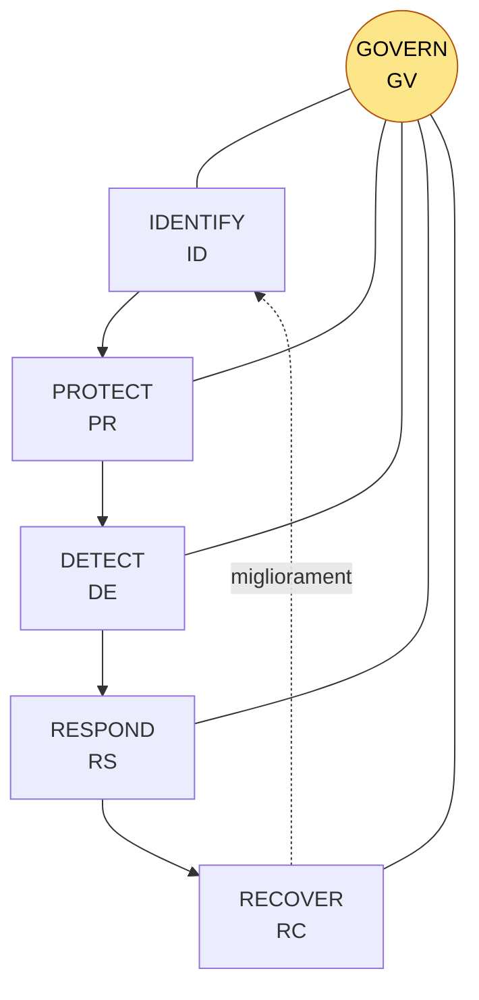

# NIST Cybersecurity Framework 2.0 (CSF 2.0) e Framework nazionale

> **Perché serve all'orale DTD1**
> - È il linguaggio comune della governance della sicurezza.
> - Le **misure di base NIS2 dell'ACN** usano la sua struttura e i suoi codici (GV, ID, PR, DE, RS, RC) attraverso il **Framework nazionale per la cybersecurity e la data protection, edizione 2025**.
> - Collega il tema della sicurezza a quello della **governance e della responsabilità dei vertici**, che è un taglio da funzionario del DTD.
>
> **Fonti**
> - NIST, *The NIST Cybersecurity Framework (CSF) 2.0*, **CSWP 29, 26 febbraio 2024**.
> - ACN, pagina NIS «Modalità e specifiche di base».
> - ACN, *Linee guida per le specifiche di base*, settembre 2025: misure organizzate per funzioni e categorie del Framework nazionale 2025, con codici come GV.OC-04, GV.RR-02, GV.PO-01, GV.SC-01, ID.RA-05, PR.DS-11.
> - Delibera AGCOM 82/26/CONS, secondo cui la **determinazione ACN 379907 del 18/12/2025 aggiorna e sostituisce la 164179 del 14/04/2025**.

## 1. Coordinate
| Voce | CSF 1.1 (2018) | **CSF 2.0 (26/02/2024)** |
|---|---|---|
| Titolo | *Framework for Improving **Critical Infrastructure** Cybersecurity* | *The **NIST Cybersecurity Framework** 2.0*, pensato per **tutte le organizzazioni**, di qualsiasi dimensione e settore, PA comprese |
| Funzioni | 5 (Identify, Protect, Detect, Respond, Recover) | **6**: si aggiunge **GOVERN**, che sta al centro delle altre |
| Struttura | 23 categorie, 108 sottocategorie | **22 categorie, 106 sottocategorie** |
| Materiale di supporto | Informative References nel documento | Risorse online: **Implementation Examples**, **Quick-Start Guides**, **Community Profiles**, Informative References consultabili online (CPRT) |
| Natura | volontario, non prescrittivo | volontario e **orientato ai risultati** (*outcomes*): dice *che cosa* ottenere, non *come* |

**I tre componenti**
- **Core**: funzioni → categorie → sottocategorie, cioè i risultati da raggiungere.
- **Profili organizzativi**: il profilo **attuale** (*Current*) e quello **obiettivo** (*Target*). La distanza tra i due è la **gap analysis** e porta a un **piano d'azione**.
- **Tier**, da 1 a 4: **Partial → Risk Informed → Repeatable → Adaptive**. Indicano il **rigore** con cui l'organizzazione governa e gestisce il rischio cyber. Non sono livelli di maturità dei singoli controlli.

## 2. Il Core: 6 funzioni, 22 categorie

| Funzione | Scopo | Categorie (codice) |
|---|---|---|
| **GOVERN (GV)** — *nuova* | Stabilire, comunicare e monitorare **strategia, aspettative e politiche** di gestione del rischio cyber | **GV.OC** contesto organizzativo · **GV.RM** strategia di gestione del rischio · **GV.RR** ruoli, responsabilità e poteri · **GV.PO** politiche · **GV.OV** supervisione · **GV.SC** rischio della **supply chain** |
| **IDENTIFY (ID)** | Capire i **rischi** attuali | **ID.AM** asset · **ID.RA** valutazione del rischio · **ID.IM** **miglioramento**, che raccoglie anche le *lezioni apprese* |
| **PROTECT (PR)** | Applicare le **salvaguardie** | **PR.AA** identità, autenticazione e controllo degli accessi · **PR.AT** consapevolezza e formazione · **PR.DS** sicurezza dei dati · **PR.PS** sicurezza delle piattaforme · **PR.IR** resilienza dell'infrastruttura |
| **DETECT (DE)** | **Trovare e analizzare** possibili attacchi o compromissioni | **DE.CM** monitoraggio continuo · **DE.AE** analisi degli eventi avversi |
| **RESPOND (RS)** | **Agire** su un incidente rilevato | **RS.MA** gestione dell'incidente · **RS.AN** analisi · **RS.CO** segnalazione e comunicazione · **RS.MI** mitigazione |
| **RECOVER (RC)** | **Ripristinare** asset e operazioni | **RC.RP** esecuzione del piano di ripristino · **RC.CO** comunicazione durante il ripristino |

> **Gancio mnemonico**: **«G + I-P-D-R-R»**. *Governo* al centro, poi *Identifico, Proteggo, Rilevo, Rispondo, Ripristino*.
> **Conteggio delle categorie**: GV **6** · ID **3** · PR **5** · DE **2** · RS **4** · RC **2** = **22**.

## 3. Che cosa cambia rispetto alla 1.1 (le domande «trabocchetto»)
1. **GOVERN** è la novità principale. Raccoglie in una funzione propria gli elementi di governance che prima erano sparsi, soprattutto in ID.GV, ID.BE e ID.RM, e dichiara la cybersicurezza un **rischio d'impresa** di cui rispondono i **vertici**.
2. La **supply chain** passa da ID.SC a **GV.SC** e diventa una questione di governance.
3. Le **lezioni apprese** non stanno più in RS.IM e RC.IM, ma in **ID.IM (Improvement)**, che copre il miglioramento di tutte le funzioni.
4. **PROTECT** cambia struttura: **PR.AA** sostituisce PR.AC, **PR.PS** (piattaforme) e **PR.IR** (resilienza) prendono il posto di PR.IP, PR.MA e PR.PT.
5. **DETECT** passa a 2 categorie: **DE.CM** e **DE.AE**. Scompare DE.DP, perché i processi di rilevamento confluiscono altrove.
6. Arrivano i **Community Profiles** (profili di settore) e gli **esempi di implementazione**, e i riferimenti si consultano online.
7. **NIST SP 800-61 Rev. 3** (aprile 2025) riscrive la risposta agli incidenti sulle **6 funzioni del CSF 2.0** (si veda `orale/07`).

> **Attenzione nei quiz**: le domande con «le **cinque** funzioni» si riferiscono alla **1.1**. Nella **2.0** le funzioni sono **sei**. Un'opzione come «Recover comprende le lezioni apprese» era corretta per la 1.1. Nella 2.0 le lezioni apprese stanno in **ID.IM**, mentre RC comprende il ripristino e la relativa comunicazione.

## 4. Il Framework nazionale e le misure di base NIS2
- **Storia**:
  - nel **2015-2016** nasce il **Framework nazionale per la cybersecurity** (CIS Sapienza e CINI, con il sostegno istituzionale), un adattamento del NIST CSF alla realtà italiana;
  - nel **2019** esce l'edizione con la **data protection**, che integra il GDPR;
  - nel **2025** esce l'**edizione 2025**, che l'ACN usa per le misure NIS. I codici delle misure, come **GV.OC-04, GV.RR-02, GV.PO-01, GV.SC-01, ID.RA-05, PR.PS-01, PR.IR-03, PR.DS-11**, seguono la **struttura del CSF 2.0**, compresa la funzione GOVERN.
- **D.Lgs. 138/2024 (NIS)**: l'ACN stabilisce le **modalità e specifiche di base** per gli obblighi degli artt. **23** (organi di amministrazione e direttivi), **24** (misure di gestione del rischio), **25** (notifica degli incidenti), **29** e **32**.
- **Determinazioni ACN**: la **379907 del 18/12/2025** **aggiorna e sostituisce** la **164179 del 14/04/2025**.
  - Gli allegati distinguono le misure per i soggetti **importanti** (all. 1) e **essenziali** (all. 2), e i criteri per gli **incidenti significativi** (all. 3 e 4).
  - Le linee guida ACN sulla versione 2025 contano **37 misure e 87 requisiti** per gli importanti e **43 misure e 116 requisiti** per gli essenziali.
  - Una fonte secondaria indica gli stessi numeri anche per la 379907. Verifica sugli allegati.
- **Scadenze**, che decorrono dalla comunicazione di inserimento nell'elenco NIS:
  - **notifica degli incidenti** entro **9 mesi**, cioè **gennaio 2026** per chi è stato inserito nel 2025;
  - **misure di base** entro **18 mesi**, cioè **ottobre 2026**.
  - All'orale puoi dire che **le misure sono ormai pienamente esigibili** per i soggetti del primo elenco.
- **Le PA centrali sono soggetti essenziali** per legge (art. 6, c.1, lett. e, D.Lgs. 138/2024).
- **Flessibilità**: molti requisiti valgono «per almeno i **sistemi informativi e di rete rilevanti**» (misura **GV.OC-04**: elenco dei sistemi rilevanti) oppure «in accordo agli esiti della **valutazione del rischio**» (**ID.RA-05**). Si applica il principio di **proporzionalità**.

## 5. Raccordi
| Riferimento | Rapporto con il CSF 2.0 |
|---|---|
| **ISO/IEC 27001:2022** | La 27001 è **certificabile** (ISMS, clausole 4-10 + Annex A con 93 controlli), mentre il CSF è un **quadro di risultati** non certificabile. GV corrisponde alle clausole 4-6 e 9-10; le altre funzioni corrispondono ai controlli dell'Annex A. Il NIST pubblica le corrispondenze tra i due |
| **NIS2** (art. 21 dir. / art. 24 D.Lgs. 138/2024) | Le 10 aree di misure (analisi del rischio, gestione degli incidenti, continuità, supply chain, MFA, crittografia, formazione…) si distribuiscono sulle 6 funzioni; la **responsabilità dei vertici** (art. 23) corrisponde a **GV.RR / GV.OV** |
| **ISO/IEC 27035** / NIST 800-61 r3 | Corrispondono a **DE + RS + RC**, con il miglioramento in **ID.IM** (`orale/07`) |
| **CRA** | Corrisponde a **GV.SC** (supply chain) e **ID.RA** (vulnerabilità dei prodotti): è il lato fornitore (`orale/06`) |
| **L. 90/2024** | Il **referente per la cybersicurezza** e la struttura dedicata corrispondono a **GV.RR**; gli elementi di cybersicurezza nei contratti ICT corrispondono a **GV.SC** |
| **DORA** | Per il settore finanziario: ICT risk management framework, test (TLPT/TIBER), terze parti ICT. Le categorie del CSF si riconoscono nei 5 pilastri |

## 6. Uso pratico per il DTD e le PA
1. **Profilo attuale**: assessment delle sottocategorie, partendo dai **sistemi rilevanti** (GV.OC-04) e dall'inventario degli asset (ID.AM).
2. **Profilo obiettivo**: le misure di base ACN per soggetti essenziali o importanti, più gli obiettivi del Piano Triennale e della Strategia nazionale di cybersicurezza.
3. **Gap analysis e piano d'azione** con priorità basate sul rischio (ID.RA), budget e responsabili (GV.RR).
4. **Approvazione da parte dei vertici** e **supervisione periodica** (GV.OV, art. 23 NIS).
5. **Misura del miglioramento**, con **ID.IM** e un passaggio di Tier verso *Repeatable*.

Per un programma di PA locali, il DTD o l'ACN potrebbero definire un **Community Profile**, un profilo comune per i Comuni di piccole dimensioni, ricavato dalle misure di base. Così si standardizzano requisiti e capitolati.

## 🎙️ Copione (90")
> «Il **NIST Cybersecurity Framework 2.0**, pubblicato nel febbraio 2024, è un quadro **volontario e orientato ai risultati** per gestire il rischio cyber. È pensato per ogni organizzazione, non più solo per le infrastrutture critiche. Ha tre componenti: il **Core**, i **profili** attuale e obiettivo, che permettono la gap analysis, e i **Tier** da 1 a 4.
> Il Core ha **sei funzioni**: **Govern**, che è la novità e sta al centro, poi **Identify, Protect, Detect, Respond e Recover**. Govern comprende contesto, strategia di rischio, **ruoli e responsabilità**, politiche, supervisione e **rischio della supply chain**. In pratica dice che la cybersicurezza è un rischio di cui rispondono i **vertici**.
> In Italia questa struttura è entrata nella normativa: le **misure di base NIS** dell'**ACN**, oggi nella **determinazione 379907 del dicembre 2025**, sono costruite sul **Framework nazionale edizione 2025**, con gli stessi codici, per esempio GV.RR per i ruoli o GV.SC per la supply chain. Questo è coerente con l'**articolo 23 del decreto NIS** sulla responsabilità degli organi di amministrazione.
> Il compromesso: il CSF è flessibile e non certificabile, a differenza della **ISO 27001**. È ottimo per misurare e comunicare, ma va tradotto in controlli concreti e proporzionati, partendo dai sistemi rilevanti e dall'analisi del rischio.»

## 🃏 Flashcard
| Domanda | Risposta |
|---|---|
| Data e sigla del CSF 2.0 | **26 febbraio 2024**, NIST **CSWP 29** |
| Quante funzioni ha la 2.0? | **6**: **Govern**, Identify, Protect, Detect, Respond, Recover |
| Quante categorie e sottocategorie? | **22** categorie e **106** sottocategorie (nella 1.1 erano 23 e 108) |
| Le 6 categorie di GOVERN | **OC** contesto · **RM** strategia di rischio · **RR** ruoli · **PO** politiche · **OV** supervisione · **SC** supply chain |
| Dove sono finite le lezioni apprese? | In **ID.IM** (Improvement) |
| Dove è finita la supply chain? | In **GV.SC** (prima era ID.SC) |
| Categorie di PROTECT | **PR.AA, PR.AT, PR.DS, PR.PS, PR.IR** |
| Categorie di DETECT | **DE.CM** (monitoraggio continuo), **DE.AE** (analisi degli eventi avversi) |
| Profilo attuale vs obiettivo | Il **Current** è lo stato di oggi, il **Target** lo stato desiderato: la differenza dà la gap analysis e il piano d'azione |
| I 4 Tier | **Partial · Risk Informed · Repeatable · Adaptive** |
| Il CSF è certificabile? | **No**. La ISO/IEC 27001 sì |
| Framework italiano usato dall'ACN per la NIS | **Framework nazionale per la cybersecurity e la data protection, ed. 2025** |
| Determinazione ACN vigente sulle specifiche di base | **379907 del 18/12/2025**, che sostituisce la **164179 del 14/04/2025** |
| Misure di base | Importanti **37 misure / 87 requisiti**; essenziali **43 / 116** (linee guida ACN 2025) |
| Scadenze NIS | Notifiche entro **9 mesi** dall'inserimento nell'elenco; misure entro **18 mesi** (ottobre 2026 per il primo elenco) |
| Che cosa richiede la misura GV.OC-04? | L'**elenco dei sistemi informativi e di rete rilevanti** |
| Le PA centrali nella NIS | Sono **soggetti essenziali** (art. 6 D.Lgs. 138/2024) |

## 🧩 Mini-caso
*Il direttore generale di un'amministrazione centrale ti chiede: «Siamo soggetto essenziale NIS, da dove partiamo e come dimostro ai vertici che stiamo migliorando?»*

1. **GOVERN prima di tutto**:
   - definisco l'organizzazione per la sicurezza, con ruoli e **referente per la cybersicurezza** (GV.RR, L. 90/2024);
   - faccio **approvare** dagli organi di vertice le politiche (GV.PO) e la strategia di rischio (GV.RM), come richiede l'art. 23 NIS.
2. **Profilo attuale**:
   - compilo l'elenco dei **sistemi rilevanti** (GV.OC-04) e l'inventario degli asset (ID.AM);
   - faccio la valutazione del rischio (ID.RA-05) e l'assessment sulle **43 misure** per i soggetti essenziali.
3. **Profilo obiettivo** = le misure di base ACN, più i requisiti di settore → **gap analysis** → **piano** con priorità basate sul rischio, costi e tempi.

   Le priorità tipiche sono:
   - MFA e accessi privilegiati (PR.AA);
   - backup immutabili (PR.DS / PR.IR);
   - monitoraggio (DE.CM);
   - piano di risposta agli incidenti e notifiche entro 24h e 72h (RS, `orale/07`);
   - clausole per i fornitori (GV.SC, con il CRA).
4. **Supervisione** (GV.OV): un **cruscotto trimestrale** per i vertici con lo stato delle misure, gli incidenti e i KPI, e il miglioramento tracciato in **ID.IM**.

## 🇬🇧 English corner
> *"The NIST Cybersecurity Framework 2.0, released in February 2024, has six functions: Govern, Identify, Protect, Detect, Respond and Recover. The new Govern function puts cybersecurity under the responsibility of top management. In Italy, the baseline security measures for NIS2 entities issued by the National Cybersecurity Agency follow the same structure."*
