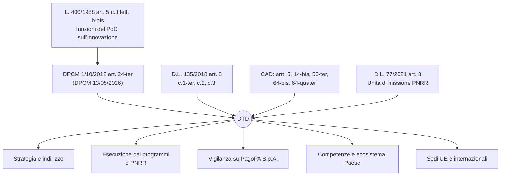
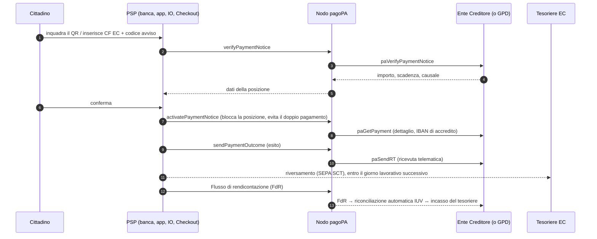
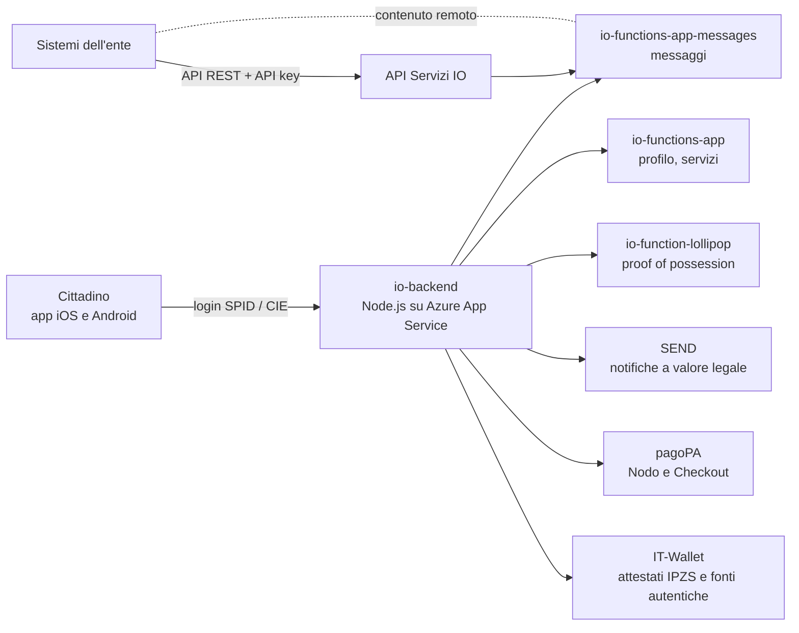

# Scheda orale 09 — Tutti i compiti del DTD, architettura di pagoPA e dell'App IO

> **Perché serve:** all'orale la domanda «che cosa fa il Dipartimento?» è quasi certa, e la commissione può chiedere a un profilo tecnico **come funziona davvero** una piattaforma nazionale. Questa scheda mette insieme norme, organizzazione e architettura.
>
> **Fonti verificate (12/11/2026):**
> - innovazione.gov.it: pagine *La struttura*, *Cosa facciamo* (agg. 17/09/2024) e *Gli uffici* (agg. 22/09/2025);
> - Decreto del 6/06/2024 (Sottosegretario all'innovazione + MEF) sull'**Unità di missione PNRR** del DTD, letto sul testo;
> - developer.pagopa.it: SANP (Allegato B alle Linee guida AgID sui pagamenti elettronici, **v3.12.0, maggio 2026**), SACI (Allegato A), specifiche dell'avviso v3.5.1, elenco API pagoPA, guida tecnica IO v7.3;
> - GitHub `pagopa/io-app` e `pagopa/io-backend`; agid.gov.it/it/piattaforme/it-wallet; Agenda Digitale (4/05/2026).
>
> ⚠️ = dato da ricontrollare prima dell'orale. Per l'art. 24-ter e il DPCM 13/05/2026 vedi [`04`](04_Scheda_DPCM_2012_Strutture_PCM.md).

---

## 1. I compiti del DTD, livello per livello



### 1.1 Il nucleo normativo
| Fonte | Compito |
|---|---|
| **Art. 24-ter c.1 DPCM 1/10/2012** | struttura di supporto al PdC per la **strategia unitaria** di trasformazione digitale e modernizzazione del Paese; attua le direttive del Presidente; **coordina ed esegue i programmi** |
| **Art. 24-ter (DPCM 13/05/2026)** | supporto alle funzioni dell'**art. 5 c.3 lett. b-bis) L. 400/1988** (innovazione tecnologica e transizione digitale) e a ogni ulteriore funzione dell'area |
| **Art. 24-ter c.2** | supporto per le funzioni dell'**art. 8 c.1-ter e c.3 D.L. 135/2018**, **vigilanza su PagoPA S.p.A.** (art. 8 c.2), partecipazione alle sedi internazionali e all'**agenda digitale europea** |
| **Art. 24-ter c.3** | non più di **3 Uffici e 8 Servizi** (dal 2026) + **contingente di esperti** (art. 8 c.1-quater D.L. 135/2018) |
| **Art. 14-bis CAD** | il PdC o il delegato esercita **indirizzo e vigilanza su AgID**; il **Piano triennale** lo redige AgID, il DTD lo **coordina e promuove** e lo approva l'autorità politica |

### 1.2 Le cinque aree di competenza (pagina «Cosa facciamo»)
1. **Trasformazione digitale della PA**: indirizzo, coordinamento e impulso su programmi, progetti e piani; valuta le proposte delle amministrazioni; **controlla l'attuazione e l'uso delle risorse**.
2. **Open government e patrimonio informativo pubblico**: indirizzi strategici sui dati (collegamento con PDND e dati aperti).
3. **Trasformazione del Paese fuori dalla PA**: indirizzi, incentivi, fondi, ecosistema tecnologico per imprese e cittadini.
4. **Competenze digitali** in scuola, università, ricerca, PA, giustizia, imprese, lavoro: **Strategia nazionale per le competenze digitali** e iniziativa **Repubblica Digitale**.
5. **Collaborazione con le autorità di cybersicurezza**: il DTD non è autorità cyber (lo è l'**ACN**), ma ci lavora insieme, ad esempio sulla **Strategia Cloud Italia** e sul **PSN**.

### 1.3 Programmi e piattaforme che il DTD guida
| Ambito | Ruolo del DTD | Chi gestisce |
|---|---|---|
| **pagoPA, App IO, SEND, PDND** | indirizzo, vigilanza sulla società, finanziamento PNRR | **PagoPA S.p.A.** |
| **IT-Wallet** (art. 64-quater CAD, D.L. 19/2024) | **titolare e coordinatore strategico** | PagoPA (wallet pubblico in IO), **IPZS** (registro e attestati di identità), AgID (regole e vigilanza), ACN (sicurezza) |
| **SPID / CIE / ANPR** | misura PNRR 1.4.4 | AgID (SPID), Interno e IPZS (CIE, ANPR) |
| **Cloud e PSN** | Strategia Cloud Italia (con ACN), misure 1.1 e 1.2 | PSN S.p.A., ACN (qualificazione) |
| **Banda ultralarga e 5G** | misure M1C2 inv. 3 | Infratel, MIMIT |
| **Fascicolo sanitario elettronico** | M6C2 1.3.1, quota digitale | Ministero della Salute, Regioni |
| **Intelligenza artificiale** | strategia nazionale IA ⚠️ (L. 132/2025: predisposta dalla struttura PCM competente per la trasformazione digitale, d'intesa con le autorità; verifica l'articolo) | AgID e ACN, autorità nazionali IA |
| **Comitato interministeriale per la transizione digitale** (D.L. 22/2021) ⚠️ | supporto all'autorità delegata | PCM |

### 1.4 Il DTD come amministrazione titolare del PNRR
L'**Unità di missione PNRR** (art. 8 c.1 D.L. 77/2021; organizzazione: **Decreto 6/06/2024**) coordina gestione, monitoraggio, rendicontazione e controllo, emana **Linee guida** per i soggetti attuatori e partecipa alla **Rete dei referenti antifrode** presso l'Ispettorato generale PNRR del MEF, con la Guardia di Finanza. Ha **3 Servizi**:
| Servizio | Contenuto |
|---|---|
| **1 – Gestione e monitoraggio** | avvisi a regia (costi reali e **lump sum**) per M1C1 **1.1, 1.2, 1.3.1, 1.4.1, 1.4.3** (inclusa la **Convenzione con PagoPA S.p.A.**), **1.4.4, 1.4.5, 1.4.6**; presidia l'inv. **1.7** e i controlli formali sulle misure attuate da AgID e PagoPA; registrazione dei dati su **ReGiS** (L. 178/2020 c.1043) |
| **2 – Gestione e monitoraggio** | accordi **ex art. 15 L. 241/1990** e interventi a titolarità: **1.5 cybersicurezza**, 1.6, riforme 1.1-1.3, **M1C2 3.1-3.5**, **M6C2 1.3.1 FSE**; Fondo complementare |
| **3 – Circuito finanziario, rendicontazione e controllo** | flussi finanziari, validazione dei dati, rendiconti di misura all'IG PNRR, **recupero delle somme indebite** |

### 1.5 Organizzazione interna (pagina *Gli uffici*, 22/09/2025)
- **Ufficio per l'indirizzo tecnologico**: strategia unitaria e direttive del Presidente. Ha due Servizi:
  - *iniziative di sistema per il settore pubblico*: programmi PA, supporto normativo, cittadinanza digitale, open government, competenze, monitoraggio;
  - *innovazione e attività internazionali*: misure per imprese e cittadini, sedi UE.
- **Ufficio per la gestione amministrativa**: bilancio, contratti e convenzioni, personale ed esperti, anticorruzione e trasparenza.
- **Unità di missione PNRR**, con i 3 Servizi della tabella sopra.
- **Transformation office**.
- ⚠️ Il DPCM 13/05/2026 porta il limite a **3 Uffici e 8 Servizi**. Il nuovo decreto di organizzazione interna, da adottare entro 30 giorni, non risultava ancora pubblicato sul sito al 12/11/2026.

### 1.6 Chi fa che cosa (domanda classica)
| Soggetto | Natura | In una riga |
|---|---|---|
| **DTD** | Dipartimento PCM | **decide la strategia e finanzia** |
| **AgID** | agenzia (art. 19 D.L. 83/2012) | **regole tecniche, linee guida, Piano triennale, vigilanza CAD** |
| **ACN** | agenzia (D.L. 82/2021) | **cybersicurezza**: NIS2, PSNC, qualificazione cloud |
| **PagoPA S.p.A.** | società partecipata dallo Stato (art. 8 c.2 D.L. 135/2018) | **costruisce e gestisce le piattaforme**: pagoPA, IO, SEND, PDND |
| **IPZS / Sogei** | società pubbliche | CIE e attestati IT-Wallet / sistemi della fiscalità |

---

## 2. pagoPA: architettura

### 2.1 Base giuridica
- **Art. 5 CAD**: obbligo per PA e gestori di pubblici servizi di accettare pagamenti elettronici tramite una **piattaforma tecnologica** per l'interconnessione tra PA e prestatori di servizi di pagamento (PSP), resa disponibile dalla Presidenza del Consiglio. **AgID, sentita Banca d'Italia**, emana le **Linee guida** e le specifiche dei codici di pagamento.
- **D.L. 135/2018 art. 8**: trasferisce la gestione **da AgID alla PCM** e costituisce **PagoPA S.p.A.**
- Documenti tecnici:
  - **Linee guida** AgID (GU 3/07/2018);
  - **Allegato A – SACI**: codici IUV, riversamento, rendicontazione;
  - **Allegato B – SANP**: specifiche del Nodo, **v3.12.0, maggio 2026**.
- Standard di riferimento: **SEPA / ISO 20022**, allineamento alla **PSD2**.

### 2.2 Attori
| Attore | Ruolo |
|---|---|
| **Ente Creditore (EC)** | PA, società a controllo pubblico non quotate, gestori di pubblici servizi: crea la **posizione debitoria** |
| **PSP** | banche, Poste, istituti di pagamento e IMEL: incassano dal cittadino; dichiarano servizi e **commissione massima** nel *Catalogo Dati Informativi* |
| **Intermediario / Partner tecnologico** | collega uno o più EC al Nodo per loro conto (Regioni, in-house, software house) |
| **Istituto tesoriere** | riceve il **riversamento** delle somme sul conto dell'EC (anche Banca d'Italia) |
| **Cittadino / impresa** | paga dal canale che preferisce |
| **PagoPA S.p.A.** | gestore del **Nodo dei Pagamenti-SPC** e dei componenti centrali |

### 2.3 Componenti centrali
- **Nodo dei Pagamenti-SPC**: hub di interconnessione tra EC e PSP. Instrada, verifica e garantisce l'**unicità del pagamento**.
- **GPD – Gestione Posizioni Debitorie**: API REST con cui l'EC **deposita le posizioni su pagoPA** invece di esporle dai propri sistemi. Il Nodo risponde al posto dell'EC, che quindi non ha bisogno di un endpoint sempre attivo. Prevede anche caricamento massivo, recupero delle ricevute e dei flussi di rendicontazione.
- **ACA – Archivio Centralizzato Avvisi**: posizioni caricate centralmente, utili per enti con sistemi poco evoluti.
- **Checkout**: web-app per pagare dai dati dell'avviso **senza registrazione**.
- **Pagamento dal sito dell'EC**: API che avvia un **carrello fino a 5 avvisi**.
- **FdR – Flussi di rendicontazione**: upload e download tra PSP, Nodo ed EC.
- **Back office / Area Riservata (Selfcare)**: adesioni, stazioni, IBAN, utenti per EC, PSP e partner tecnologici.
- Altre funzioni: **stampa avvisi** via API (PDF), **eBollo 2.0** (marca da bollo digitale), **opzioni di pagamento** (`verifyPaymentOptions`: rate, sconti).
- **Canali**: home banking, sportelli, ATM, tabaccherie, app dei PSP, **App IO** e Checkout.

### 2.4 Avviso di pagamento e QR code
- **Codice avviso (18 cifre)** = **AUX digit + Application code + IUV**. Lo **IUV** (Identificativo Univoco di Versamento) accompagna il pagamento in tutto il suo ciclo di vita.
- Il pagamento è identificato dalla coppia **Codice fiscale dell'EC + Codice avviso**.
- Contenuto del **QR code** (ISO/IEC 18004, livello di correzione M):
  ```text
  PAGOPA|002|<codice avviso 18>|<CF ente creditore 11>|<importo in centesimi>
  esempio: PAGOPA|002|000000000000000000|01199250158|0000015000   → 150,00 €
  ```
- Modelli di avviso: **rata unica e/o più rate**, obbligatori per gli EC che consentono il pagamento presso i PSP.

### 2.5 Flusso del «modello unico» (pagamento avviato presso il PSP)



- Le interfacce SOAP si chiamano **nodeForPsp, pspForNode, nodeForPa, paForNode**; le API più recenti (GPD, FdR, ACA, recupero ricevute) sono **REST**.
- ⚠️ Le primitive indicate (ad esempio `paGetPayment` o `paSendRT`, con le varianti V2) seguono le specifiche SANP 3.x pubblicate nel repository `pagopa/pagopa-api`. Per l'orale basta la logica: **verifica → attivazione → esito → ricevuta → rendicontazione**.
- **Riconciliazione**: l'EC incrocia la **ricevuta** (per IUV) con il **flusso di rendicontazione** (identificativo del flusso, che raggruppa più pagamenti) e con l'**accredito del tesoriere**. In questo modo l'incasso si chiude senza lavoro manuale.
- **Benefici (SANP)**:
  - per l'EC: **accredito entro il giorno successivo** e riconciliazione automatica;
  - per i PSP: **un solo accordo** valido con tutte le PA;
  - per il cittadino: costi trasparenti e libertà di scegliere il canale.

### 2.6 Sicurezza e compromessi (taglio *security-first*)
| Rischio | Contromisura | Compromesso |
|---|---|---|
| Doppio pagamento o pagamento di un importo superato | **attivazione** con blocco della posizione; IUV univoco | latenza in più e gestione dei timeout |
| EC non raggiungibile | **GPD/ACA**: il Nodo risponde al posto dell'EC | dati delle posizioni concentrati su pagoPA, quindi più impatto in caso di violazione |
| Intercettazione o falsificazione dei messaggi | canali cifrati TLS con **autenticazione forte dei client** (certificati, **chiavi di sottoscrizione** sul gateway API) ⚠️ verifica i dettagli SANP | ciclo di vita di certificati e chiavi (rotazione, revoca) |
| Phishing con falsi avvisi o falsi link | QR standard, verifica dell'importo presso l'EC, avvisi **in IO** come canale fidato | educazione degli utenti; ingegneria sociale fuori dal controllo tecnico |
| Punto unico di guasto nazionale | alta affidabilità, monitoraggio, **NIS2** (PagoPA come soggetto rilevante ⚠️), DORA lato PSP | costi e complessità di esercizio |

---

## 3. App IO: architettura

### 3.1 Che cos'è e base giuridica
- **Punto di accesso telematico** ai servizi della PA (**art. 64-bis CAD**, Linee guida AgID 2021): un'unica app per **messaggi, pagamenti, documenti e servizi** di tutte le PA. È sviluppata e gestita da **PagoPA S.p.A.**
- Ospita il **wallet pubblico IT-Wallet** (**art. 64-quater CAD**, introdotto dal **D.L. 19/2024**, convertito dalla L. 56/2024).

### 3.2 Componenti tecnici

- **App**: **React Native** + Expo modules, **TypeScript**, Redux/Redux-Saga e XState, monorepo Nx. È **open source**: repository `github.com/pagopa/io-app`, licenza EUPL-1.2 indicata nel repository ⚠️.
- **Backend**: `io-backend` in **Node.js** dietro Nginx, eseguito su **Microsoft Azure** (App Service, code Azure Storage, Application Insights). Chiama microservizi serverless `io-functions-*` per profilo, messaggi e carte.
- **Lollipop**: meccanismo di **proof of possession**. La chiave è generata nel **keystore hardware** del telefono, e le richieste firmate dimostrano che arrivano dal dispositivo legato alla sessione. Riduce il furto e il riuso dei token.
- **Compatibilità**: il backend espone la **versione minima dell'app** (`/info`), così le versioni vulnerabili o obsolete possono essere bloccate.

### 3.3 Come un ente usa IO
1. **Adesione** dall'**Area Riservata** (selfcare.pagopa.it) con un accordo. Un **ente aggregatore** può operare per altri enti su mandato.
2. **Crea il servizio**, lo prova in **test**, lo sottopone alla **revisione di PagoPA** e poi lo rende visibile. Esistono modelli già pronti: TARI, CIE, asilo nido, multe.
3. **API key** formata da una coppia **primaria e secondaria**, così una chiave si può ruotare senza interrompere il servizio. La vede e la rigenera solo l'amministratore dell'ente. Non va mai inserita nel codice client: le chiamate partono dal **backend dell'ente**.
4. **Invio di un messaggio** al singolo cittadino tramite **codice fiscale**: non esistono invii massivi in una sola chiamata.
   - Prima si verifica che il profilo esista e che il cittadino non abbia disattivato quel servizio (*Get profile*, *Subscriptions feed*).
   - Poi si invia (*Submit message*) e si controlla l'esito (*Get message*).
5. **Tipi di messaggio**:
   - **standard**;
   - con **avviso pagoPA** incorporato, così il cittadino paga dall'app;
   - con **allegati PDF/A**;
   - **a contenuto remoto**: il testo resta sui sistemi dell'ente e viene recuperato a ogni lettura, adatto ai dati sensibili;
   - **Premium**: conferma di lettura e di pagamento.
6. **Errori**: il codice `429` indica il superamento del rate limit e va gestito con *retry* e *backoff*.
7. **Firma con IO**: l'ente può chiedere al cittadino di firmare documenti e contratti.

### 3.4 IT-Wallet in IO («Documenti su IO»)
| Data | Fatto |
|---|---|
| **marzo 2024** | il **D.L. 19/2024** istituisce il Sistema IT-Wallet: un **wallet pubblico in IO** più **wallet privati** accreditati |
| luglio 2024 | sperimentazione: **patente**, **tessera sanitaria**, **carta europea della disabilità** |
| **4 dicembre 2024** | apertura a tutti i maggiorenni in IO |
| marzo 2026 | oltre **11 milioni** di attivazioni (dato Agenda Digitale) |
| luglio-ottobre 2026 | ⚠️ secondo la pagina AgID: **DPCM sugli organismi nazionali per l'identità digitale europea**, **Linee guida del Sistema IT-Wallet** (7/10/2026) e **Regolamento di registrazione** (4/11/2026) |
| **24/12/2026** | termine per la **convergenza con l'EUDI Wallet** (Reg. UE 2024/1183, eIDAS 2) |

- **Ruoli**:
  - **DTD**: titolare e coordinatore strategico;
  - **PagoPA**: wallet pubblico;
  - **IPZS**: registro IT-Wallet e **attestati di identificazione personale**, rilasciati solo dopo autenticazione **CieID** di livello elevato;
  - **AgID**: regole e vigilanza;
  - **ACN**: requisiti di sicurezza;
  - **fonti autentiche**: INPS, MIT, MEF, ANPR, ministeri di istruzione e università.
- **Principi**:
  - attestati **verificati alla fonte**;
  - **divulgazione selettiva** (mostro solo «maggiorenne», non la data di nascita);
  - **nessuna tracciabilità** da parte di chi rilascia l'attestato;
  - uso anche **offline**.
- **Finanziamento**: 102 milioni di euro per il 2024-2026 (art. 64-quater c.6).

### 3.5 Compromessi di sicurezza e privacy di IO
- **Centralizzazione**: un solo canale facilita UX e sicurezza (canale fidato contro il phishing), ma è un **obiettivo di alto valore** e un punto unico di guasto. Servono quindi resilienza, rilevamento delle anomalie e conformità NIS2.
- **Minimizzazione dei dati (GDPR art. 5 e 25)**: il **contenuto remoto** e la divulgazione selettiva nel wallet riducono i dati che transitano su PagoPA. Il prezzo è la dipendenza dalla disponibilità dei sistemi dell'ente.
- **Cloud pubblico (Azure)**: elasticità e servizi gestiti, ma serve governare **localizzazione dei dati, qualificazione ACN e strategia di uscita** (Strategia Cloud Italia).
- **Open source**: trasparenza e riuso (artt. 68-69 CAD); il codice è pubblico anche per gli attaccanti, ma la sicurezza non si basa sulla segretezza del codice (*no security through obscurity*).

---

## 4. Domande probabili e risposte lampo
| Domanda | Risposta in una riga |
|---|---|
| Che cosa fa il DTD? | **strategia unitaria, esecuzione dei programmi, PNRR M1C1, vigilanza su PagoPA S.p.A., competenze digitali, sedi UE** |
| Differenza tra DTD e PagoPA S.p.A.? | il DTD **indirizza e finanzia**, PagoPA **progetta ed esercisce** le piattaforme |
| Chi scrive le regole di pagoPA? | **AgID, sentita Banca d'Italia** (art. 5 CAD): Linee guida + SACI + SANP |
| Come si evita il doppio pagamento? | **IUV univoco + attivazione** della posizione sul Nodo |
| Che cos'è la GPD? | posizioni debitorie **ospitate su pagoPA**: l'EC non deve esporre un servizio sempre attivo |
| Come arriva il denaro all'ente? | il PSP **riversa** al tesoriere e invia il **flusso di rendicontazione**; l'EC riconcilia per IUV |
| IO invia messaggi massivi? | **no**: una chiamata per ogni codice fiscale, e il cittadino può disattivare il servizio |
| Dati sensibili in un messaggio IO? | **contenuto remoto** o allegato, più minimizzazione |
| Che cos'è IT-Wallet? | wallet pubblico in IO (art. 64-quater CAD) verso l'**EUDI Wallet** di eIDAS 2 |

## 🎙️ Copione (90")
> Il **Dipartimento per la trasformazione digitale** è la struttura con cui il Presidente del Consiglio definisce una **strategia unitaria** e assicura **l'esecuzione dei programmi** digitali. In concreto fa cinque cose:
> - indirizza la trasformazione della PA, insieme ad **AgID**, che scrive le regole tecniche;
> - è **amministrazione titolare** della Missione 1 Componente 1 del PNRR, con un'Unità di missione che gestisce avvisi, monitoraggio e rendicontazione;
> - **vigila su PagoPA S.p.A.**, la società che gestisce le piattaforme nazionali;
> - promuove le **competenze digitali**;
> - rappresenta il Governo nelle sedi europee.
>
> **pagoPA** è un nodo di interconnessione tra enti creditori e prestatori di servizi di pagamento. Ogni pagamento ha un **IUV** univoco. Il prestatore verifica la posizione, la **attiva** per evitare il doppio pagamento e invia l'esito; il Nodo trasmette la **ricevuta** all'ente. Poi il prestatore riversa le somme al tesoriere e invia il **flusso di rendicontazione**, così l'ente riconcilia gli incassi in modo automatico.
>
> L'**app IO** è il punto di accesso telematico previsto dal CAD. Gli enti inviano messaggi via API, con chiave primaria e secondaria, al singolo codice fiscale, anche con un avviso pagoPA allegato o con contenuto remoto per i dati sensibili. Dentro IO c'è il **wallet pubblico IT-Wallet**, che converge verso il portafoglio europeo di eIDAS 2.
>
> Dal punto di vista della sicurezza, la centralizzazione è un vantaggio contro il phishing ma è anche un obiettivo di alto valore: per questo servono resilienza, minimizzazione dei dati e conformità NIS2.

## 🎯 Da ricordare
- **DTD = strategia + esecuzione + PNRR + vigilanza su PagoPA + competenze + UE.** Unità di missione con **3 Servizi** (Decreto 6/06/2024).
- **pagoPA**: art. 5 CAD; D.L. 135/2018; regole AgID (sentita Banca d'Italia); **SANP v3.12.0 (maggio 2026)**; **codice avviso a 18 cifre = AUX + Application code + IUV**; QR `PAGOPA|002|…`; **verifica → attivazione → esito → ricevuta → rendicontazione**.
- **IO**: art. 64-bis CAD; React Native e TypeScript, backend Node.js su Azure, open source; **Lollipop** (proof of possession); API key primaria e secondaria; un messaggio per codice fiscale; contenuto remoto; avviso pagoPA nel messaggio; `429` = rate limit.
- **IT-Wallet**: D.L. 19/2024, art. 64-quater CAD; generale dal **4/12/2024**; IPZS per gli attestati di identità; convergenza con l'EUDI Wallet al 24/12/2026.
