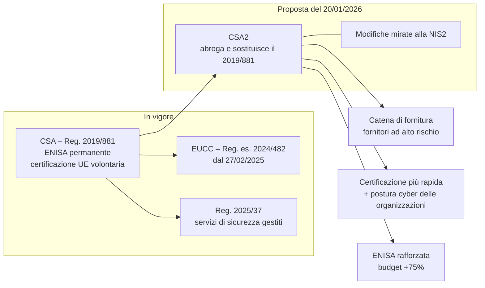
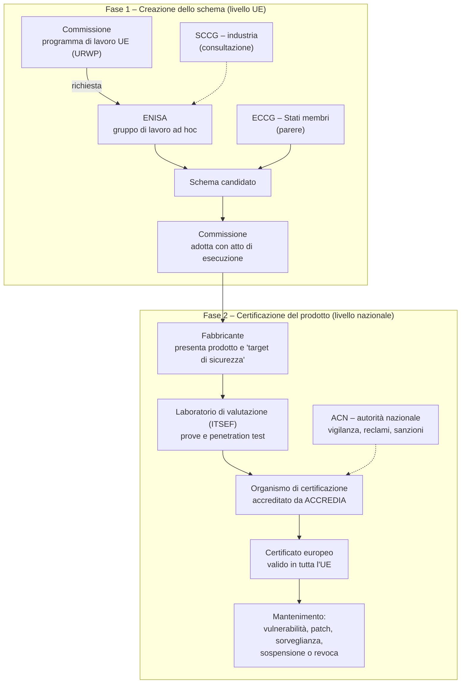

# Scheda orale 10 — Cybersecurity Act (Reg. UE 2019/881) e proposta di revisione «CSA2»

> **Perché serve:** completa il trittico europeo della cybersicurezza, in cui ogni atto copre un oggetto diverso:
> - **NIS2** riguarda i **soggetti**;
> - il **CRA** ([`06`](06_Scheda_Cyber_Resilience_Act.md)) riguarda i **prodotti**;
> - il **Cybersecurity Act** riguarda la **certificazione** e l'**ENISA**. Con la revisione CSA2 si aggiungerebbe la **catena di fornitura ICT**.
>
> **Fonti (verificate il 14/11/2026):**
> - testo del Reg. UE 2019/881;
> - Reg. di esecuzione UE 2024/482 (EUCC);
> - Reg. UE 2025/37;
> - analisi della proposta CSA2 del 20/01/2026: eucrim (19/02/2026), Mayer Brown (20/02/2026), Cullen International, Hogan Lovells, Mondaq (relazione del Consiglio del 22/05/2026).
>
> ⚠️ Il **CSA2 è una proposta**, quindi **non è in vigore**. Al 14/11/2026 è in negoziazione tra Parlamento e Consiglio.

---

## 1. Il Cybersecurity Act in vigore (Reg. UE 2019/881)
- È un **regolamento**: si applica direttamente, senza recepimento. È **in vigore dal 27/06/2019**.
- **Titolo II – ENISA**: l'Agenzia dell'UE per la cybersicurezza riceve un **mandato permanente**, prima a termine. Supporta gli Stati, la rete dei CSIRT, le esercitazioni e la cooperazione operativa, e prepara gli schemi di certificazione.
- **Titolo III – Quadro europeo di certificazione** (ECCF) per **prodotti, servizi e processi ICT**:
  - **chi fa cosa**: l'**ENISA** prepara lo schema candidato su richiesta della Commissione; l'**ECCG** (gruppo degli Stati membri) dà il parere; la **Commissione** adotta lo schema con atto di esecuzione;
  - **effetto**: un certificato rilasciato in uno Stato **vale in tutta l'UE**;
  - **è volontario**, salvo che il diritto UE o nazionale lo renda obbligatorio (art. 24 NIS2; prodotti *critici* del CRA);
  - **autorità nazionale di certificazione**: in Italia è l'**ACN** (D.L. 82/2021).
- **Livelli di affidabilità**:

| Livello | Rischio coperto | Valutazione |
|---|---|---|
| **Base** | rischi noti, incidenti comuni | ammessa l'**autovalutazione** del fabbricante |
| **Sostanziale** | attaccanti con capacità e risorse limitate | organismo terzo |
| **Elevato** | attacchi sofisticati, con capacità e risorse significative | organismo terzo e **test di penetrazione** |

- **Schemi**:
  - **EUCC** (basato sui *Common Criteria*, ISO/IEC 15408): Reg. di esecuzione 2024/482, **applicabile dal 27/02/2025**; sostituisce l'accordo **SOG-IS** tra Stati;
  - **EUCS** (servizi cloud): fermo da anni sul tema della **sovranità**, cioè i requisiti di immunità dalle leggi extra-UE;
  - **EU5G** (reti 5G): in preparazione.
- **Reg. UE 2025/37**: modifica il CSA per rendere certificabili anche i **servizi di sicurezza gestiti** (risposta agli incidenti, penetration test, audit, consulenza). È legato al *Cyber Solidarity Act* e alla riserva europea di cybersicurezza.

### 1.1 Come funziona la certificazione, passo per passo
> In breve: l'UE scrive uno **schema** con le regole di valutazione. Un **laboratorio accreditato** testa il prodotto, un **organismo di certificazione** rilascia il certificato e l'**ACN** vigila. Il certificato **vale in tutta l'UE**, ma **non è definitivo**: va mantenuto, va gestito ogni volta che emerge una vulnerabilità e può essere revocato.

**Fase 1: chi scrive le regole**
| Attore | Ruolo |
|---|---|
| **Commissione** | fissa le priorità nel **programma di lavoro UE** (*Union Rolling Work Programme*), chiede lo schema all'ENISA e lo **adotta con atto di esecuzione** |
| **ENISA** | prepara lo **schema candidato** con un gruppo di esperti |
| **ECCG** | gruppo degli **Stati membri** (per l'Italia l'ACN): dà il parere |
| **SCCG** | industria, consumatori, università: viene consultato |

**Cosa contiene uno schema (art. 54 CSA)**
- oggetto e ambito, cioè quali prodotti copre;
- **norme tecniche** di valutazione (ad esempio ISO/IEC 15408 *Common Criteria* e ISO/IEC 18045);
- **livelli di affidabilità** previsti;
- se è ammessa l'**autovalutazione**;
- requisiti per laboratori e organismi;
- **durata** del certificato e regole di **sorveglianza**;
- come si gestiscono e si comunicano le **vulnerabilità**;
- contenuto del certificato e dell'etichetta.

**Fase 2: come si certifica un prodotto (esempio EUCC)**
1. **Dossier del fabbricante**:
   - il **target di sicurezza** (*Security Target*): che cosa promette il prodotto, contro quali minacce, in quale ambiente;
   - la documentazione di progetto, le interfacce o il codice, i processi di sviluppo e consegna.
2. **Valutazione del laboratorio** (ITSEF, *IT Security Evaluation Facility*):
   - verifica che il prodotto faccia ciò che dichiara;
   - analizza le **vulnerabilità** e fa **test di penetrazione**, più profondi al crescere del livello.
3. **Rilascio del certificato** da parte dell'**organismo di certificazione**, che deve essere **accreditato** da **ACCREDIA** (Reg. CE 765/2008). Per il **livello elevato** serve in più l'**autorizzazione dell'ACN**.
4. **Pubblicazione**: certificato e rapporto sono pubblicati e valgono in **tutti i 27 Stati**, senza ripetere i test.
5. **Mantenimento nel tempo**:
   - il titolare deve **monitorare e gestire le vulnerabilità** e comunicarle;
   - le modifiche, come le patch, vanno valutate: possono richiedere un aggiornamento o una **ricertificazione**;
   - per l'**EUCC** la validità massima è di **5 anni**, estendibile solo con l'autorizzazione dell'ACN (art. 12 Reg. 2024/482, modificato dal **Reg. di esecuzione 2025/2462**);
   - in caso di problemi il certificato può essere **sospeso o revocato**.

**Livelli e profondità dei test**
| Livello CSA | Contro chi | Chi valuta | EUCC |
|---|---|---|---|
| **Base** | rischi noti, attacchi elementari | **autovalutazione** (dichiarazione UE di conformità), se lo schema la ammette | non previsto |
| **Sostanziale** | attaccanti con capacità limitate | laboratorio e organismo accreditati | **AVA_VAN 1-2** |
| **Elevato** | attacchi sofisticati con risorse significative | laboratorio e organismo accreditati, **autorizzati dall'ACN** | **AVA_VAN 3-5** |

*AVA_VAN* è la componente dei Common Criteria che misura la **resistenza agli attacchi**: più alto è il valore, più potente è l'attaccante simulato.

**Chi vigila: l'ACN**
- È l'**autorità nazionale di certificazione** (art. 7 c.1 lett. e D.L. 82/2021).
- Dal **2022** ha assorbito l'**OCSI**, l'organismo che dal 2003 gestiva lo schema nazionale *Common Criteria* presso il MIMIT (prima MISE). Il passaggio è avvenuto con il DPCM del 15/06/2022.
- Con l'EUCC lo **schema nazionale non rilascia più nuovi certificati**.
- Compiti: vigila su organismi e titolari, **gestisce i reclami**, **autorizza** gli organismi per il livello elevato, può **revocare** e **sanzionare**.
- Le autorità nazionali si controllano a vicenda con la ***peer review*** (art. 59 CSA).
- **Da non confondere**:
  - il **CVCN**, che valuta le forniture ICT del Perimetro di sicurezza nazionale cibernetica;
  - lo schema per le **informazioni classificate**, gestito dall'Autorità nazionale per la sicurezza.

**Tipi diversi di «certificazione»**
| Strumento | Che cosa certifica | Obbligatorio? | Esito |
|---|---|---|---|
| **CSA / EUCC** | un **prodotto** ICT rispetto al suo target di sicurezza | volontario, salvo che lo imponga una norma | certificato UE con livello di affidabilità |
| **CRA**: valutazione di conformità | un **prodotto** rispetto ai requisiti essenziali | **obbligatoria** per il mercato UE | **marcatura CE**; per i prodotti critici può essere richiesta la certificazione CSA |
| **ISO/IEC 27001** | il **sistema di gestione** dell'organizzazione | volontario (spesso richiesto nelle gare) | certificato triennale con audit annuali di sorveglianza |
| **Postura cyber** (CSA2, proposta) | la sicurezza di un'**organizzazione** | volontario | possibile **presunzione di conformità NIS2** |
| **Qualificazione cloud ACN** | servizi e infrastrutture **cloud per la PA** | **obbligatoria** per vendere cloud alle PA | iscrizione al catalogo ACN |
| **CVCN** | forniture ICT per i soggetti del **Perimetro** | **obbligatorio** per quelle forniture | valutazione e prove, eventualmente con prescrizioni |

**Compromessi**
| Pro | Contro |
|---|---|
| **fiducia verificata da terzi**, non autodichiarata | **costosa e lenta** (mesi), poco adatta a software con rilasci frequenti |
| **un certificato per 27 Stati** | è una **fotografia** di una versione in una configurazione: una nuova vulnerabilità o un errore di configurazione la superano |
| permette di confrontare le offerte negli appalti | rischio di adempimento formale («certificato quindi sicuro») |
| la gestione obbligatoria delle vulnerabilità rende la certificazione un processo continuo | il **target di sicurezza** può essere troppo ristretto: va sempre letto |

**In una gara della PA:**
1. chiedi il **livello adeguato al rischio** (ad esempio *sostanziale* per componenti di sicurezza critici);
2. **leggi il target di sicurezza**, per verificare che copra l'uso reale;
3. imponi nel contratto la **gestione delle vulnerabilità** e il mantenimento del certificato;
4. ricorda che la certificazione **non sostituisce** hardening, monitoraggio e patching.

#### 🎙️ Copione certificazione (30")
> La certificazione del Cybersecurity Act funziona in due tempi.
>
> A livello europeo l'ENISA prepara uno schema, gli Stati danno il parere nel gruppo ECCG e la Commissione lo adotta.
>
> A livello nazionale un laboratorio accreditato valuta il prodotto, con test di penetrazione più profondi al crescere del livello di affidabilità, e un organismo accreditato da Accredia rilascia il certificato, valido in tutta l'Unione. L'ACN vigila e autorizza gli organismi per il livello elevato.
>
> Il certificato dura al massimo cinque anni, va mantenuto gestendo le vulnerabilità e può essere revocato. Per questo in una gara chiederei il livello adeguato, leggerei il perimetro certificato e imporrei la gestione delle vulnerabilità nel contratto.

## 2. La proposta CSA2 (20/01/2026)
È presentata in un **pacchetto** insieme alle **modifiche mirate alla NIS2**. Se approvata, **abrogherebbe il Reg. 2019/881**.

### 2.1 Catena di fornitura ICT: la novità politica
- Introduce un **quadro orizzontale per i rischi non tecnici**, cioè il **paese di origine** e l'**influenza di governi terzi** sul fornitore. È la logica della **5G Toolbox** del 2020, che da raccomandazione diventerebbe **regola**.
- Dopo una **valutazione coordinata del rischio** fatta da Stati e Commissione, la Commissione designa con **atti di esecuzione**:
  1. i **paesi terzi** che pongono problemi di cybersicurezza;
  2. i **fornitori ad alto rischio** legati a quei paesi;
  3. gli **asset ICT chiave** usati dai soggetti NIS2.
- **Conseguenze per i fornitori designati**:
  - restrizioni o **eliminazione graduale** dei loro componenti nei settori critici, con **periodi transitori** (⚠️ le analisi parlano di **massimo 36 mesi per il 5G**);
  - **esclusione dagli appalti** per componenti ICT chiave;
  - **esclusione dai finanziamenti UE**;
  - **divieto di ottenere la certificazione UE**.
- **Sanzioni**: **fino al 7% del fatturato mondiale annuo**, secondo il tipo di violazione.

### 2.2 Certificazione più rapida e più ampia
- Procedure di adozione **più chiare** e un meccanismo di **manutenzione** degli schemi, per rispondere alle critiche di lentezza (il caso EUCS).
- L'**ENISA** gestisce gli schemi e, di regola, prepara lo schema candidato **entro 12 mesi** dalla richiesta della Commissione.
- **Ambito esteso**: prodotti, servizi, processi, **servizi di sicurezza gestiti** e **«postura cyber» delle organizzazioni** (*cybersecurity posture*), cioè non solo il singolo prodotto.
- **Collegamento con la NIS2**: il certificato di postura potrebbe dare una **presunzione di conformità** agli obblighi NIS2.
- Resta **volontaria**, ma può diventare **obbligatoria di fatto** tramite appalti, richieste del mercato o norme nazionali.

### 2.3 ENISA rafforzata
- **Budget oltre +75%**; ogni Stato designa **due funzionari di collegamento**.
- **Nuovi compiti operativi**:
  - **allerte precoci** a livello UE;
  - supporto contro il **ransomware**, con Europol e la rete dei CSIRT;
  - servizi di **gestione delle vulnerabilità** e mantenimento della **European Vulnerability Database (EUVD)**;
  - repertori europei di minacce e incidenti;
  - coordinamento delle esercitazioni, standardizzazione, *Cybersecurity Skills Academy*.
- **Piattaforma unificata di notifica degli incidenti**: il *single entry point* è previsto dal **Digital Omnibus**, e l'ENISA lo gestirebbe. Obiettivo: **segnalare una volta sola** invece di notificare più volte per NIS2, CRA, GDPR e DORA. ⚠️ Il ruolo esatto va verificato sul testo finale.

### 2.4 Modifiche mirate alla NIS2 (nello stesso pacchetto)
- Chiarimenti su ambito, definizioni e regole di **giurisdizione** (meno oneri per i gruppi multinazionali).
- Nuova categoria **small mid-cap**.
- Raccolta più snella dei dati sul **ransomware**.
- Coordinamento ENISA sulla vigilanza dei soggetti transfrontalieri.
- Ambito esteso, **indipendentemente dalla dimensione**, a:
  - **fornitori di wallet digitali** (eIDAS 2, quindi anche IT-Wallet: vedi [`09`](09_Scheda_Compiti_DTD_PagoPA_IO.md));
  - **cavi e infrastrutture sottomarine**;
  - infrastrutture a **duplice uso**.
- Strategie nazionali con politiche di **migrazione alla crittografia post-quantistica**.

### 2.5 Stato dell'iter
| Data | Passaggio |
|---|---|
| 20/01/2026 | proposta della Commissione (CSA2 + modifiche NIS2) |
| 19/03/2026 | parere congiunto **EDPB-EDPS** |
| 22/05/2026 | **relazione sullo stato dei lavori del Consiglio**: diversi Stati contestano la **base giuridica**, perché la sicurezza nazionale è competenza degli Stati (art. 4 c.2 TUE); è chiesto il parere del Servizio giuridico |
| lug-dic 2026 | presidenza irlandese del Consiglio, che punta a un orientamento o accordo politico |
| 2027 | probabile conclusione dei triloghi; poi applicazione con periodi transitori |

---

## 3. Come si incastrano le norme UE
| Atto | Oggetto | Obbligo chiave | Autorità IT |
|---|---|---|---|
| **NIS2** (Dir. 2022/2555, D.Lgs. 138/2024) | **soggetti** essenziali e importanti | gestione del rischio, notifiche 24h/72h/1 mese, responsabilità degli organi di vertice | ACN |
| **CRA** (Reg. 2024/2847) | **prodotti** con elementi digitali | sicurezza fin dalla progettazione, SBOM, segnalazioni dall'11/09/2026, marcatura CE | ACN (⚠️ d.lgs. in corso) |
| **CSA** (Reg. 2019/881) | **certificazione** e ENISA | volontaria (EUCC); obbligatoria se lo impone NIS2 o CRA | ACN come autorità di certificazione |
| **CSA2** (proposta) | + **catena di fornitura** e postura | esclusione dei fornitori ad alto rischio; certificazione delle organizzazioni | Commissione + Stati |

**Raccordi da citare:**
- **CRA → CSA**: per i prodotti **critici** (All. IV, ad esempio smart card) può essere richiesta la certificazione **EUCC**; un certificato CSA dà la **presunzione di conformità** ai requisiti essenziali del CRA.
- **NIS2 → CSA**: l'**art. 24 NIS2** permette agli Stati di imporre prodotti, servizi o processi certificati; con il CSA2 la **certificazione di postura** potrebbe dimostrare la conformità NIS2.
- **Italia**: il **CVCN** (Centro di valutazione e certificazione nazionale) valuta gli acquisti ICT del **Perimetro di sicurezza nazionale cibernetica**; il ***golden power*** sul 5G (D.L. 21/2012) anticipa a livello nazionale la logica dei fornitori ad alto rischio; la **qualificazione cloud ACN** si incontra con il tema della sovranità dell'EUCS.

## 4. Compromessi di sicurezza
| Pro | Contro e rischi |
|---|---|
| meno **dipendenza da paesi terzi** nelle infrastrutture critiche (sovranità digitale) | **costi di sostituzione** (*rip and replace*) e ritardi per gli operatori di telecomunicazioni e per le PA |
| un solo criterio UE invece di 27 regimi nazionali | **base giuridica** contestata; rischio di contenzioso |
| certificazione = fiducia, mercato unico, acquisti più semplici | possibile **protezionismo** e attriti in sede OMC; schemi lenti |
| certificazione di postura = meno oneri per la conformità NIS2 | rischio di **adempimento formale** («certificato quindi sicuro»): la certificazione fotografa un momento e non sostituisce il **monitoraggio continuo** |
| segnalazione unica = meno notifiche doppie | piattaforma centrale ENISA = **obiettivo di alto valore**, da proteggere |

## 5. Impatto per il DTD e per gli acquisti della PA
- **Capitolati**: richiedere prodotti **EUCC** almeno di livello *sostanziale* per componenti critici, e premiarli nell'**OEPV** come in [`06`](06_Scheda_Cyber_Resilience_Act.md); in futuro prevedere clausole di **esclusione dei fornitori ad alto rischio** e piani di uscita.
- **Gestione del rischio di fornitura**: mappare gli **asset ICT chiave** e i fornitori (misure NIS2 della determinazione ACN 379907/2025, categoria **GV.SC** del NIST CSF 2.0: vedi [`08`](08_Scheda_NIST_CSF_2_0.md)).
- **Cloud e PSN**: la qualificazione ACN e il dibattito EUCS sono lo stesso tema di **localizzazione e controllo giurisdizionale dei dati** della Strategia Cloud Italia.
- **Programmi PNRR e piattaforme nazionali** (pagoPA, IO, PDND): componenti e servizi gestiti certificati riducono il rischio di catena di fornitura su un punto unico nazionale.

## 6. Domande lampo
| Domanda | Risposta in una riga |
|---|---|
| Numero e anno del Cybersecurity Act? | **Reg. UE 2019/881**, in vigore dal 27/06/2019 |
| Due pilastri? | **ENISA permanente** + **quadro europeo di certificazione** |
| La certificazione è obbligatoria? | **No, è volontaria**; diventa obbligatoria se lo impone il diritto UE o nazionale (NIS2 art. 24, prodotti critici del CRA) |
| Livelli di affidabilità? | **base** (autovalutazione ammessa), **sostanziale**, **elevato** |
| Primo schema adottato? | **EUCC** (Common Criteria), Reg. di esecuzione 2024/482, dal 27/02/2025 |
| Perché l'EUCS è fermo? | requisiti di **sovranità e immunità** dalle leggi extra-UE |
| Chi adotta gli schemi? | **Commissione** con atto di esecuzione, su schema candidato **ENISA** e parere **ECCG** |
| Autorità di certificazione in Italia? | **ACN** |
| Chi testa e chi certifica? | il **laboratorio (ITSEF)** valuta; l'**organismo di certificazione accreditato** (ACCREDIA) rilascia; l'**ACN** vigila |
| Che cos'è il *Security Target*? | il documento in cui il fabbricante dichiara **funzioni di sicurezza, minacce e ambiente**: definisce il perimetro di ciò che viene certificato |
| EUCC: livelli e AVA_VAN? | **sostanziale = AVA_VAN 1-2**, **elevato = AVA_VAN 3-5** (per l'elevato serve l'autorizzazione dell'ACN) |
| Durata di un certificato EUCC? | **massimo 5 anni**, estendibile solo con l'autorizzazione dell'ACN; può essere sospeso o revocato |
| Che fine ha fatto l'OCSI? | dal **2022** è confluito nell'**ACN**; con l'EUCC lo schema nazionale non rilascia più nuovi certificati |
| Differenza tra EUCC e ISO 27001? | EUCC certifica un **prodotto**; ISO 27001 certifica il **sistema di gestione** di un'organizzazione |
| Cosa aggiunge il Reg. 2025/37? | certificazione dei **servizi di sicurezza gestiti** |
| Che cos'è il CSA2? | proposta del **20/01/2026** che **abroga** il 2019/881: catena di fornitura, certificazione più rapida, ENISA rafforzata |
| Fornitori ad alto rischio: chi decide? | la **Commissione** con atti di esecuzione, dopo una valutazione coordinata del rischio con gli Stati |
| Sanzione massima del CSA2? | **7% del fatturato mondiale** |
| Nuovo oggetto certificabile? | la **postura cyber** dell'organizzazione, con possibile presunzione di conformità NIS2 |
| Perché il Consiglio frena? | la **sicurezza nazionale** è competenza degli Stati (art. 4 c.2 TUE): dubbi sulla base giuridica |
| Differenza tra CSA e CRA? | CSA = certificazione **volontaria**; CRA = requisiti **obbligatori** per immettere il prodotto sul mercato (marcatura CE) |

## 🎙️ Copione (90")
> Il **Cybersecurity Act**, regolamento UE 2019/881, ha due pilastri.
>
> Il primo è l'**ENISA**, che ha ottenuto un **mandato permanente** e più compiti operativi.
>
> Il secondo è il **quadro europeo di certificazione** per prodotti, servizi e processi ICT. Gli schemi li prepara l'ENISA, gli Stati danno il parere e la Commissione li adotta. Un certificato vale in tutta l'Unione, su tre livelli di affidabilità: base, sostanziale ed elevato. La certificazione è **volontaria**, ma la NIS2 e il Cyber Resilience Act possono renderla obbligatoria, ad esempio per i prodotti critici. Il primo schema è l'**EUCC**, basato sui Common Criteria e applicato dal febbraio 2025; quello sul cloud è fermo sul nodo della sovranità.
>
> Il 20 gennaio 2026 la Commissione ha proposto il **CSA2**, che sostituirebbe il regolamento. Le novità sono tre:
> - la **catena di fornitura**: la Commissione potrà designare i **fornitori ad alto rischio** di paesi terzi ed escluderli dai settori critici, dagli appalti e dai fondi europei, con sanzioni fino al 7% del fatturato;
> - una certificazione più rapida, estesa alla **postura cyber delle organizzazioni**, utile per la conformità NIS2;
> - un'ENISA più forte, con allerte precoci e una piattaforma unica di notifica.
>
> È ancora in negoziazione, anche perché alcuni Stati ne contestano la base giuridica.
>
> Per una PA questo significa capitolati che chiedono prodotti certificati e fornitori affidabili, coerenti con NIS2, CRA e regole ACN, senza confondere il certificato con la sicurezza continua.

## 🎯 Da ricordare
- **NIS2 = soggetti · CRA = prodotti · CSA = certificazione + ENISA · CSA2 = + catena di fornitura.**
- **2019/881**, dal 27/06/2019; livelli **base / sostanziale / elevato**; **EUCC** dal 27/02/2025 (Reg. es. 2024/482); **2025/37** per i servizi di sicurezza gestiti; **ACN** autorità nazionale.
- **Filiera della certificazione**: schema (Commissione, ENISA, ECCG) → **laboratorio ITSEF** → **organismo accreditato ACCREDIA** → certificato UE → **ACN** vigila. EUCC: sostanziale = AVA_VAN 1-2, elevato = 3-5; **max 5 anni**; vulnerabilità da gestire; OCSI confluito nell'ACN (2022).
- **CSA2**: proposta del **20/01/2026**; fornitori ad alto rischio designati dalla Commissione; esclusione da appalti, fondi e certificazione; **7%**; schema candidato in **12 mesi**; **postura cyber**; ENISA **+75%** di budget; **non ancora in vigore**.
