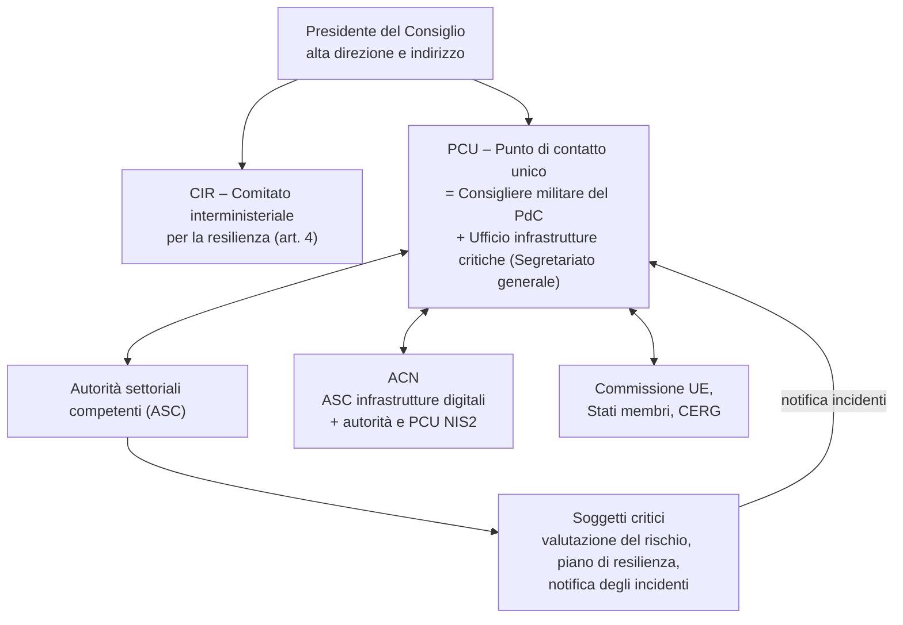
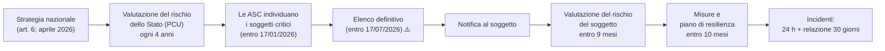

# Scheda orale 11 — Direttiva CER: resilienza dei soggetti critici (Dir. UE 2022/2557, D.Lgs. 134/2024)

> **Perché serve:** la CER è la «gemella fisica» della NIS2, recepita nello stesso periodo:
> - la **NIS2** protegge **reti e sistemi informativi**;
> - la **CER** protegge la **continuità dei servizi essenziali** dagli eventi **fisici** (naturali, accidentali, dolosi, ibridi).
>
> In Italia l'architettura è **in Presidenza del Consiglio**. Il punto di contatto unico è il **Consigliere militare del Presidente**: un aggancio naturale per un ufficiale di Marina. Parlane solo in termini generali, senza dettagli operativi o classificati.
>
> **Fonti verificate (14/11/2026):**
> - D.Lgs. 4/09/2024 n. 134 su Normattiva (art. 1, premesse, note; GU n. 223 del 23/09/2024; in vigore dal **18/10/2024**);
> - **Strategia nazionale per la resilienza dei soggetti critici, aprile 2026**, letta sul testo;
> - Decreto del Segretario generale PCM del 29/05/2026, letto sul testo, registrato alla Corte dei conti il 30/06/2026;
> - ICT Security Magazine (gennaio 2026), Cybersecurity360, Diritto Bancario (Atto del Governo n. 438).
>
> ⚠️ = dato da fonte secondaria o non verificato sul testo del decreto.

---

## 1. Le norme
| Livello | Atto | Nota |
|---|---|---|
| UE | **Direttiva (UE) 2022/2557** del 14/12/2022 («CER», *Critical Entities Resilience*) | abroga la **Dir. 2008/114/CE** sulle infrastrutture critiche europee, che copriva **solo energia e trasporti** |
| UE | **Reg. delegato (UE) 2023/2450** | elenco dei **servizi essenziali** per settore |
| Italia | **D.Lgs. 134/2024**, attuativo della delega dell'art. 5 della L. 15/2024 (legge di delegazione europea 2022-2023) | abroga il **D.Lgs. 61/2011** dal 18/10/2024 |
| Italia | **DPCM 2/04/2025** | supporto al punto di contatto unico (modifica anche il DPCM sull'Ufficio del Consigliere militare) |
| Italia | **Strategia nazionale, aprile 2026** (art. 6 del D.Lgs. 134/2024) | ⚠️ adottata in ritardo: il termine era il 17/07/2025 |
| Italia | **Decreto del Segretario generale 29/05/2026** | rafforza l'**Ufficio infrastrutture critiche (UIC)** con un posto dirigenziale generale per analisi degli scenari, rischi e interdipendenze |
| Italia | Schema di DPCM attuativo (**Atto del Governo n. 438**, agosto 2026) | ⚠️ da verificare se è stato adottato |

## 2. Ambito: 11 settori
**Energia · trasporti · settore bancario · infrastrutture dei mercati finanziari · sanità · acqua potabile · acque reflue · infrastrutture digitali · pubblica amministrazione · spazio · filiera alimentare.**

- **Banche, infrastrutture dei mercati finanziari e infrastrutture digitali**: si applicano solo in parte. Per questi soggetti **non valgono** l'art. 12 (cooperazione con gli Stati membri) e i **Capi III** (resilienza), **IV** (particolare rilevanza europea) e **VI** (vigilanza ed esecuzione), perché sono già coperti da **DORA** (Reg. UE 2022/2554) e **NIS2**.
- La CER riguarda il **rischio fisico**. Il rischio cyber resta alla NIS2, che si coordina con la CER.

## 3. Governance italiana (Strategia nazionale, aprile 2026)

| Attore | Ruolo |
|---|---|
| **Presidente del Consiglio** | condotta strategica unitaria, **alta direzione**, coordinamento delle politiche |
| **CIR** – Comitato interministeriale per la resilienza (art. 4), presso la PCM | supporta l'alta direzione; ne fanno parte le amministrazioni che sono autorità settoriali o hanno competenze funzionali alla resilienza |
| **PCU** – Punto di contatto unico, presso la PCM | è il **Consigliere militare del PdC**, con il supporto dell'**Ufficio infrastrutture critiche** del **Segretariato generale** (art. 32 DPCM 1/10/2012: vedi [`04`](04_Scheda_DPCM_2012_Strutture_PCM.md)). Coordina le autorità, tiene il raccordo con la Commissione, gli Stati membri e i paesi terzi, **riceve le notifiche di incidente** e fa la **valutazione del rischio nazionale** |
| **Autorità settoriali competenti (ASC)** | individuano i soggetti critici, vigilano, ricevono le notifiche e **sanzionano** |
| **ACN** | ASC per le **infrastrutture digitali** e autorità/PCU per la **NIS2**: è il ponte tra rischio fisico e rischio cyber. Con il Ministero della Difesa è autorità di **gestione delle crisi informatiche** |
| Altri raccordi | **Protezione civile** (emergenze); Segretariato generale per il **golden power**; **Commissione interministeriale tecnica di difesa civile** del Ministero dell'Interno, con la rete delle Prefetture |

**Autorità settoriali per settore**
| Settore | ASC |
|---|---|
| Energia, risorse idriche (acqua potabile e reflue) | **MASE** (Ambiente e sicurezza energetica) |
| Trasporti, acque irrigue | **MIT** (Infrastrutture e trasporti) |
| Bancario, infrastrutture dei mercati finanziari | **MEF**, con **Banca d'Italia** e **Consob** |
| Sanità | **Ministero della Salute** e **AIFA** |
| Infrastrutture digitali | **ACN**, con il **MIMIT** |
| **Spazio** e **pubbliche amministrazioni** | **Presidenza del Consiglio** |
| Alimentare | **MASAF** (Agricoltura e sovranità alimentare) |

## 4. Il ciclo degli obblighi

**Obblighi degli Stati (PCU e ASC)**
- Strategia nazionale e valutazione del rischio dello Stato.
- Individuare i soggetti critici: fornitori di un **servizio essenziale**, che operano **sul territorio** e la cui interruzione avrebbe un **effetto dirompente significativo**.
- Vigilanza e sanzioni.

**Come è stata fatta la valutazione del rischio nazionale**
1. **Identificazione e classificazione** dei rischi naturali, tecnologici e antropici (accidentali e dolosi), intersettoriali e transfrontalieri.
2. **Analisi delle vulnerabilità** di ogni sottosettore.
3. **Valutazione degli impatti** sistemici su salute, sicurezza pubblica, società, economia e mercato interno.

- Scala usata: **nullo / basso / medio / medio-alto / alto**, data da gravità × probabilità.
- È stato valutato il **rischio inerente**, cioè senza tenere conto delle misure già in atto.
- Sono stati integrati il meccanismo unionale di protezione civile e l'analisi dell'**AIPSA** (associazione dei professionisti della security aziendale).

**Obblighi dei soggetti critici**
- **Valutazione del rischio** su tutti i rischi pertinenti, entro **9 mesi** dalla notifica ⚠️.
- **Misure tecniche, di sicurezza e organizzative** adeguate e proporzionate, descritte in un **piano di resilienza**, entro **10 mesi** ⚠️. Servono a:
  1. **prevenire** gli incidenti (gestione del rischio, adattamento climatico);
  2. **proteggere** fisicamente gli impianti (perimetro, controllo degli accessi, sorveglianza);
  3. **rispondere**, resistere e mitigare;
  4. **ripristinare** (continuità operativa, catene di fornitura alternative);
  5. gestire la **sicurezza del personale**, compresi i **controlli dei precedenti** per i ruoli sensibili;
  6. **formare** il personale e fare **esercitazioni**.
- **Notifica degli incidenti** che perturbano in modo significativo il servizio: **entro 24 ore** dalla conoscenza, poi **relazione dettagliata entro 30 giorni** ⚠️. La notifica va all'autorità e al PCU, su una **piattaforma digitale unica**.
- **Sanzioni amministrative**: ⚠️ da **25.000 a 125.000 €** secondo le fonti secondarie, da verificare sul testo.

**Livello europeo**
- **Soggetti critici di particolare rilevanza europea**: servono **6 o più Stati membri**; la Commissione può inviare **missioni di consulenza**.
- **CERG** (*Critical Entities Resilience Group*): il gruppo di coordinamento tra Stati e Commissione.

## 5. La Strategia nazionale (aprile 2026)
- **Principi**: **«all hazards – whole of government – whole of society»**.
- **Contesto**: minacce ibride, clima, interdipendenze; riferimenti al Rapporto Niinistö, al Libro bianco *Readiness 2030* e alla *Preparedness Union Strategy*.
- **Resilienza fin dalla progettazione** (*by design*) per le nuove infrastrutture, anche sulla base di valutazioni del **Ministero della Difesa**, estendendo la metodologia già usata per i sistemi a **duplice uso**.
- **Tre obiettivi strategici**:
  1. **Comprendere** lo stato attuale della resilienza, comprese dipendenze e interdipendenze intersettoriali e transfrontaliere.
  2. **Raggiungere e mantenere** un livello elevato di resilienza, per la continuità dei servizi anche con eventi naturali, accidentali o dolosi.
  3. **Promuovere cooperazione e coordinamento** a livello nazionale, europeo e internazionale, tra pubblico e privato.
- La **resilienza della PA** attraversa tutti gli obiettivi.
- Sono previste **misure per i soggetti critici di piccole e medie dimensioni**.
- Si coordina con la **Strategia nazionale di cybersicurezza 2022-2026**.

## 6. CER, NIS2, Perimetro e DORA
| | **CER** (D.Lgs. 134/2024) | **NIS2** (D.Lgs. 138/2024) | **PSNC** (D.L. 105/2019) | **DORA** (Reg. 2022/2554) |
|---|---|---|---|---|
| Oggetto | resilienza **fisica** dei servizi essenziali | sicurezza di **reti e sistemi** | sicurezza di reti, sistemi e servizi ICT per le **funzioni essenziali dello Stato** | resilienza **operativa digitale** del settore finanziario |
| Come si entra | **individuazione** da parte dell'ASC e notifica | per **dimensione e settore**, con registrazione | **elenco riservato** (DPCM) | per tipo di entità finanziaria |
| Incidenti | 24 h / 30 gg | 24 h / 72 h / 1 mese | 1 h / 6 h | secondo gli standard tecnici di regolamentazione |
| Autorità | **ASC + PCU in PCM** | **ACN** | **ACN** | Banca d'Italia, Consob, IVASS |

- **Ponte normativo**: un **soggetto critico CER è anche soggetto essenziale NIS2**, quindi deve rispettare **entrambi** gli obblighi, fisici e cyber.
- **Ponte istituzionale**: l'**ACN** è sia ASC CER (per le infrastrutture digitali) sia autorità NIS2.

## 7. Compromessi
| Scelta | Vantaggio | Costo o rischio |
|---|---|---|
| Approccio a **tutti i rischi** | visione completa del rischio | integrare funzioni separate (security fisica, IT, gestione del rischio, continuità operativa); costo organizzativo |
| **Elenco dei soggetti riservato** | non fornisce una mappa degli obiettivi a chi vuole colpire | meno trasparenza; coordinamento della catena di fornitura più difficile |
| **Controlli dei precedenti** del personale | riducono la **minaccia interna** | bilanciamento con **GDPR** e diritto del lavoro |
| **PCU militare in PCM** | catena di coordinamento corta, cultura della gestione delle crisi | serve un buon raccordo con le autorità civili (protezione civile, Interno, ACN) |
| **Resilienza fin dalla progettazione** sulle nuove infrastrutture | evita interventi costosi a posteriori | costi iniziali più alti e tempi di progetto più lunghi |
| Scadenze slittate (strategia di aprile 2026) | — | divario tra la norma e la protezione effettiva |

## 8. Perché conta per il DTD
- Il settore **pubbliche amministrazioni** ha come ASC la **Presidenza del Consiglio**: piattaforme e servizi della PA centrale possono rientrare nella resilienza CER.
- **Infrastrutture digitali e cloud** (PSN, data center) vanno pensati con **ridondanza geografica**, continuità operativa (ISO 22301) e protezione fisica, non solo con misure cyber.
- **Programmi PNRR** (cloud, PDND, piattaforme): richiedono **resilienza fin dalla progettazione** e dati sulle interdipendenze, come pagoPA da cui dipendono gli incassi di tutti gli enti (vedi [`09`](09_Scheda_Compiti_DTD_PagoPA_IO.md)).
- **Acquisti**: nei capitolati inserire requisiti di continuità, siti alternativi e affidabilità della catena di fornitura, coerenti con NIS2 e con la proposta CSA2 (vedi [`10`](10_Scheda_Cybersecurity_Act_CSA2.md)).

## 9. Domande lampo
| Domanda | Risposta in una riga |
|---|---|
| Che cos'è la CER? | **Dir. UE 2022/2557** sulla resilienza dei **soggetti critici**; sostituisce la Dir. 2008/114/CE |
| Recepimento italiano? | **D.Lgs. 134/2024**, in vigore dal **18/10/2024**; abroga il D.Lgs. 61/2011 |
| Quanti settori? | **11**: energia, trasporti, banche, mercati finanziari, sanità, acqua potabile, acque reflue, infrastrutture digitali, PA, spazio, alimentare |
| Differenza con la NIS2? | CER = **resilienza fisica** del servizio; NIS2 = **sicurezza cyber** dei sistemi |
| Chi è il PCU in Italia? | il **Consigliere militare del PdC**, con l'**Ufficio infrastrutture critiche** del Segretariato generale |
| Che cos'è il CIR? | **Comitato interministeriale per la resilienza** presso la PCM, a supporto dell'alta direzione del PdC |
| Chi individua i soggetti critici? | le **autorità settoriali competenti** (MASE, MIT, MEF, Salute, ACN, PCM, MASAF) |
| ASC per PA e spazio? | la **Presidenza del Consiglio** |
| Notifica degli incidenti? | **24 h** + relazione entro **30 giorni** |
| Tempi per il soggetto critico? | valutazione del rischio entro **9 mesi**, misure e piano entro **10 mesi** dalla notifica |
| Particolare rilevanza europea? | servizi in **6 o più Stati membri**; missioni di consulenza della Commissione |
| Principi della strategia? | **all hazards, whole of government, whole of society**; resilienza fin dalla progettazione |
| Tre obiettivi della strategia? | **comprendere**, **rafforzare e mantenere**, **cooperare** |
| Banche e infrastrutture digitali? | sono soggetti critici, ma molti obblighi CER sono sostituiti da **DORA e NIS2** |

## 🎙️ Copione (90")
> La **direttiva CER**, la 2022/2557, è la gemella della NIS2. La NIS2 protegge i sistemi informativi; la CER protegge la **continuità dei servizi essenziali** da eventi fisici: alluvioni, guasti, sabotaggi, terrorismo, minacce ibride. Sostituisce la vecchia direttiva del 2008, che copriva solo energia e trasporti, e si estende a **undici settori**: dall'acqua alla sanità, dallo spazio alla pubblica amministrazione.
>
> In Italia è recepita dal **decreto legislativo 134 del 2024**, e l'architettura è in **Presidenza del Consiglio**:
> - il Presidente esercita l'alta direzione, con il **Comitato interministeriale per la resilienza**;
> - il **punto di contatto unico** è il **Consigliere militare**, supportato dall'Ufficio infrastrutture critiche del Segretariato generale;
> - le **autorità settoriali**, cioè i ministeri, l'ACN e la stessa Presidenza per la PA e lo spazio, individuano i soggetti critici e vigilano.
>
> Il soggetto critico fa una valutazione del rischio, adotta un **piano di resilienza** per prevenire, proteggere, rispondere e ripristinare, e notifica gli incidenti **entro 24 ore**. Inoltre è automaticamente soggetto essenziale NIS2.
>
> La **strategia nazionale** dell'aprile 2026 segue tre principi, tutti i rischi, tutto il governo e tutta la società, e tre obiettivi: comprendere, rafforzare e cooperare.
>
> Per il DTD significa progettare piattaforme e cloud della PA con resilienza fin dall'inizio, non solo con la sicurezza informatica.

## 🎯 Da ricordare
- **CER = fisico · NIS2 = cyber · DORA = finanza · PSNC = funzioni essenziali dello Stato.**
- **Dir. 2022/2557** → **D.Lgs. 134/2024** (in vigore 18/10/2024, abroga il D.Lgs. 61/2011); **11 settori**.
- **Governance**: PdC + **CIR**; **PCU = Consigliere militare + UIC** (Segretariato generale); **ASC**: MASE, MIT, MEF (+ Banca d'Italia e Consob), Salute (+ AIFA), ACN (+ MIMIT), **PCM** (PA e spazio), MASAF.
- **Tempi**: soggetti individuati entro il 17/01/2026, elenco entro il 17/07/2026; soggetto: **9 mesi** valutazione, **10 mesi** misure; incidenti **24 h + 30 gg**.
- **Strategia, aprile 2026**: *all hazards / whole of government / whole of society*; resilienza fin dalla progettazione; obiettivi **comprendere · rafforzare · cooperare**.
