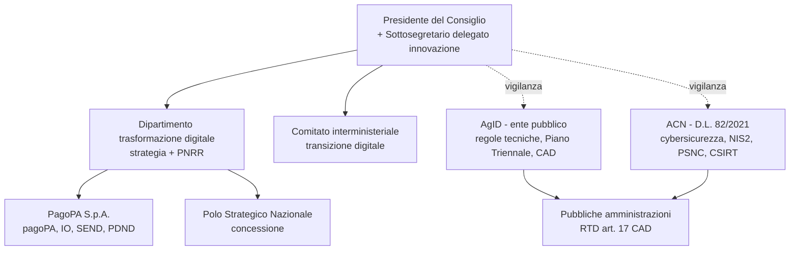

# Materia 9 — Ordinamento della Presidenza del Consiglio dei ministri (+ governance del digitale)

> Materia **assente** negli altri concorsi del repository: è quella con il miglior rapporto resa/tempo (domande "a memoria").

## 1. Fonti
| Fonte | Contenuto |
|---|---|
| **Costituzione, artt. 92-96** | Governo = **PdC + Ministri**, che insieme formano il **Consiglio dei ministri** (art. 92). Il PdR nomina il PdC e, **su proposta** di questo, i Ministri. Giuramento (art. 93). **Fiducia** delle Camere entro **10 giorni** dalla formazione (art. 94). Art. 95: il PdC **dirige la politica generale del Governo e ne è responsabile**, mantiene l'**unità di indirizzo politico e amministrativo** promuovendo e coordinando l'attività dei Ministri; i Ministri sono responsabili **collegialmente** degli atti del CdM e **individualmente** di quelli dei loro dicasteri; la legge provvede all'ordinamento della PCM. Art. 96: reati ministeriali (giurisdizione ordinaria previa autorizzazione delle Camere). |
| **L. 23 agosto 1988, n. 400** | "Disciplina dell'attività di Governo e **ordinamento** della PCM" — attuazione dell'art. 95 Cost. |
| **D.Lgs. 30 luglio 1999, n. 303** | Riforma "Bassanini" (delega art. 11 L. 59/1997): **ordinamento della PCM**, autonomia organizzativa, contabile e di bilancio. |
| **DPCM 1° ottobre 2012** e successive modifiche | **Ordinamento delle strutture generali** della PCM (Dipartimenti e Uffici). Il **DPCM 19 giugno 2019** vi inserisce il **Dipartimento per la trasformazione digitale**. |
| **D.Lgs. 165/2001, art. 35-ter, 35-quater** | Portale **inPA**, procedure concorsuali (richiamate dal bando). |

## 2. L. 400/1988 — articoli da sapere
| Art. | Contenuto |
|---|---|
| **2** | Attribuzioni del **Consiglio dei ministri**: determina la politica generale del Governo, delibera su DDL, decreti legislativi, decreti-legge, regolamenti, conflitti di attribuzione fra Ministri, ecc. |
| **5** | Attribuzioni del **Presidente del Consiglio**: indirizza le direttive ai Ministri, coordina e promuove l'attività dei Ministri, può **sospendere l'adozione di atti** dei Ministri sottoponendoli al CdM, controfirma… |
| **6** | **Consiglio di Gabinetto** (facoltativo, per coadiuvare il PdC). |
| **8** | **Vicepresidenti** del Consiglio. |
| **9** | **Ministri senza portafoglio**: svolgono funzioni **delegate dal PdC**; si avvalgono di strutture (Dipartimenti) della PCM. |
| **10** | **Sottosegretari di Stato** (fino a 10 possono avere il titolo di **Vice Ministro**); il **Sottosegretario alla PCM** è segretario del CdM. |
| **11** | **Commissari straordinari** del Governo. |
| **12** | **Conferenza Stato-Regioni**. |
| **14** | **Decreti legislativi** (art. 76 Cost.): emanati dal PdR, titolo "decreto legislativo". |
| **15** | **Decreti-legge** (art. 77 Cost.): conversione entro **60 giorni**. |
| **17** | **Regolamenti**: c.1 governativi (DPR, previo parere del **Consiglio di Stato**); c.2 **di delegificazione**; c.3 ministeriali/interministeriali (DM); c.4-bis organizzazione dei Ministeri. |
| **18** | **Segretariato generale** della PCM (il PdC se ne avvale). |

## 3. D.Lgs. 303/1999 — punti chiave
- La PCM è la struttura di cui il PdC si avvale per l'esercizio **autonomo** delle funzioni di impulso, indirizzo e coordinamento attribuite dalla Costituzione e dalle leggi.
- **Autonomia organizzativa** (art. 7): il PdC individua **con propri decreti** le aree funzionali omogenee e ne affida la cura a **Dipartimenti** o **Uffici**. Le strutture affidate a Ministri senza portafoglio o Sottosegretari sono individuate con **decreti del PdC**.
- **Autonomia contabile e di bilancio** (art. 8): la PCM ha un **proprio bilancio**; le risorse sono iscritte in un apposito fondo dello stato di previsione del **MEF**.
- **Personale**: ruolo autonomo della PCM, con un **CCNL proprio** (comparto autonomo PCM, citato nel bando: **CCNL 2019-2021 sottoscritto il 28/10/2025**, inquadramento in **categoria A, fascia F1**).
- **Segretario generale**: nominato con DPCM; vertice amministrativo e responsabile del funzionamento del Segretariato generale e della gestione delle risorse umane e strumentali. Strutture: **Dipartimenti** (per funzioni di coordinamento), **Uffici** (anche autonomi), **Uffici di diretta collaborazione** del PdC.

## 4. Dipartimento per la trasformazione digitale (DTD)
- **Istituito con DPCM 19 giugno 2019** (modifica del DPCM 1/10/2012) come struttura di supporto al PdC per **la promozione e il coordinamento delle azioni del Governo** volte a una **strategia unitaria** di trasformazione digitale e modernizzazione del Paese. Fino a **2 uffici di livello dirigenziale generale e 2 servizi**. Organizzazione interna con **decreto del Segretario generale (24 luglio 2019)**.
- **Erede del Team per la Trasformazione Digitale** (Commissario straordinario, 2016-2019).
- **Senza personalità giuridica**: è un'articolazione della PCM, distinta da **AgID** e **ACN** (agenzie con personalità giuridica).
- Opera per il **Ministro/Sottosegretario con delega all'innovazione tecnologica e alla transizione digitale** (oggi Sottosegretario alla PCM con delega).
- Ruoli chiave:
  - **Amministrazione titolare** delle misure PNRR di digitalizzazione (**M1C1 Asse 1** e banda ultralarga/5G in **M1C2**), con una **Unità di missione PNRR** dedicata; avvisi alle PA tramite la piattaforma **PA digitale 2026**.
  - Strategia **Italia Digitale 2026**, **Strategia Cloud Italia** (con ACN, 2021), **Strategia nazionale per la banda ultralarga**.
  - Vigilanza/indirizzo su **PagoPA S.p.A.** (società pubblica, art. 8 D.L. 135/2018: pagoPA, App IO, SEND, PDND) e rapporti con **AgID** (art. 14-bis CAD: AgID sottoposta ai poteri di indirizzo e vigilanza del PdC o del Ministro delegato).
  - Convenzione con **PSN** (si veda `AGID/pdf/1671199163-convenzione-dtd_polo-strategico-nazionale.pdf`).
  - **Fondo per la Repubblica Digitale** (art. 29 D.L. 152/2021, con fondazioni bancarie/ACRI) per le competenze digitali.
- **Comitato interministeriale per la transizione digitale (CITD)**: art. 8 D.L. 22/2021, presso la PCM, coordina le iniziative di trasformazione digitale delle amministrazioni.

### Mappa della governance del digitale

## 5. Altri attori collegati alla PCM (domande a trabocchetto)
| Soggetto | Natura |
|---|---|
| **AgID** | Agenzia, personalità giuridica di diritto pubblico (D.L. 83/2012), vigilata dal PdC; adotta le **Linee guida** del CAD (art. 71) e redige il **Piano Triennale** per l'informatica nella PA. |
| **ACN** | Agenzia per la Cybersicurezza Nazionale (D.L. 82/2021), personalità giuridica pubblica; **Autorità nazionale NIS** (D.Lgs. 138/2024); CSIRT Italia; qualificazione cloud PA; autorità per l'IA (vigilanza) insieme ad AgID ai sensi della **L. 132/2025**. |
| **Funzione Pubblica** | Dipartimento della PCM (riforma PA, portale **inPA**, **Formez PA**, **Commissione RIPAM**, che gestisce questo concorso). |
| **Struttura di missione PNRR** | Presso la PCM (D.L. 13/2023) — coordina l'attuazione del PNRR; al MEF l'**Ispettorato generale per il PNRR**. |
| **DIS / AISE / AISI** | Intelligence (L. 124/2007), facenti capo al PdC. |

## 🎯 Da ricordare
- **L. 400/1988** (attività di Governo e ordinamento PCM) ≠ **D.Lgs. 303/1999** (ordinamento PCM, autonomia, Bassanini) ≠ **DPCM 1/10/2012** (strutture generali).
- Art. 95 Cost.: il PdC **dirige** la politica generale e **mantiene l'unità di indirizzo**.
- Regolamenti governativi: **parere del Consiglio di Stato**; decreto-legge: **60 giorni**.
- DTD: **DPCM 19/06/2019**, **nessuna personalità giuridica**, titolare delle misure PNRR digitali.
- Ministro senza portafoglio = funzioni **delegate dal PdC**, nessun Ministero proprio.
